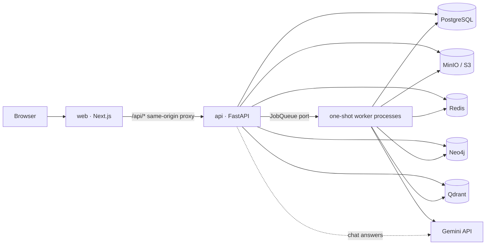

# Unfold — High-Level Design (HLD)

> Status: **as built after phases 1-3** (2026-10-10). When code and this document disagree, fix one of them in the same change.
> Decisions: [`adr/`](adr/) · Low-level design: [`LLD.md`](LLD.md) (sections 14-15 predate ADRs 0001 and 0003 and describe a LangGraph/Deep Agents design that was dropped) · AWS target: [`infra/strategy.md`](infra/strategy.md) (phase 4, nothing deployed)
> Requirements: [`specs/PRD.md`](specs/PRD.md) · [`specs/ESD.md`](specs/ESD.md)

---

## 1. What the system does

A user submits a **public GitHub URL or a ZIP**, a technical level and an optional focus instruction. Unfold
statically analyses the repository (never executing it) into a **project knowledge system**: Project IR, Neo4j graph,
BM25 index, Qdrant vectors, chunked evidence in Postgres. A fixed pipeline plans and writes a **chaptered guide** with
deterministic diagrams and graded claims. On top of the same knowledge the user can **chat** with cited, graded
answers and **export** the guide or a chat as PDF or Markdown. There is no sign-in; everything expires.

## 2. Deployable units



| Unit | Responsibility |
|---|---|
| `web` | Landing, progress (polled), guide reader, architecture, chat, exports. No analysis logic; proxies `/api/*` so the session cookie is first-party. |
| `api` | Sessions, project creation and deletion, guide/diagram/evidence/progress reads, chat (retrieval + model call in this process), export requests and downloads, an in-process sweeper loop. Never analyses or renders PDFs inline. |
| worker | **No long-lived loop.** `python -m unfold.worker.run <task> <ref>` runs one job and exits: `analysis <job_id>`, `export <export_id>`, `cleanup <project_id>`, `sweep`. Locally `SubprocessJobQueue` starts one process per job (bounded; retries on exit 75 or a crash). |
| `postgres` | Application truth: sessions, projects, jobs, stage checkpoints, progress events, chunks, guide, diagrams, chats, artifacts. |
| `redis` | Rate-limit windows (behind `RateLimiter`), LLM provider budgets/circuit/key health and per-job/per-chat usage, LLM response and embedding caches. No durable data. |
| `neo4j` / `qdrant` | Relationship graph; dense vectors (one collection, `project_id` filter). Both optional per job: failure marks the job `degraded`, retrieval adapts. |
| `minio` | ZIP uploads, IR snapshots, BM25 artifacts, export files (`projects/{id}/...`). |

Infrastructure is reached through four ports in `unfold/ports.py` (`BlobStore`, `JobQueue`, `RateLimiter`,
`ProgressStore`; ADR 0002). `JobQueue` has `enqueue_analysis`, `enqueue_project_cleanup`, `enqueue_export`.

## 3. Logical modules (Python package `unfold`)

```text
core            config, errors (envelope + codes), logging, ids
domain          enums (stages, claim status, artifact kinds), shared models
ports           BlobStore, JobQueue, RateLimiter, ProgressStore, rate-limit key helpers
persistence     postgres (SQLAlchemy async + Alembic), redis, neo4j, qdrant, object_store adapters
ingestion       github archive fetch, zip extraction with hard limits
security        secret redaction, prompt-injection scanner, untrusted-data fence
repo_intel      inventory, language/framework detection, analyzers (ast + tree-sitter)
project_ir      ProjectIR schema + builder
graph           Neo4j builder, queries, community detection
indexing        chunker, BM25, dense index, embeddings, reranker
retrieval       planner, lexical/dense/graph/structural retrievers, RRF, sufficiency, expansion
context         context compiler + token budget (redact -> fence -> label evidence)
llm             gateway, providers (gemini, groq), router, key pool, budgets, circuit breaker
orchestration   analysis pipeline (plain async stage groups + checkpoints), progress
guide           planner, section writer, deterministic claim grading
diagrams        DiagramSpec builders + Mermaid
chat            answer generator (retrieve, compile, stream, cite, grade), turn persistence
exports         HTML templates, Chromium PDF, Markdown, export job
cleanup         cleanup_project, sweeper
evaluation      offline evals, scripted model, in-memory stores (test tooling, not imported by runtime code)
agents          WorkflowFinding contracts only (no agent runtime; ADR 0001, 0009)
api / worker    the two composition roots
```

Dependency rules (enforced by `tests/unit/test_architecture.py`): `core`/`domain` are leaves; provider SDKs only under
`llm.providers`; `redis`/`minio`/`arq`/`boto3` only in adapters (documented exceptions in ADR 0002); only `api` and
`worker` are composition roots; production code never imports `evaluation`.

## 4. Flows

### Analysis (ADR 0003)

```mermaid
sequenceDiagram
  participant W as web
  participant A as api
  participant P as Postgres
  participant K as worker (analysis)
  W->>A: POST /projects/github|zip
  A->>P: project + job (queued), progress event
  A-->>W: 202 {project_id, job_id}
  A->>K: JobQueue.enqueue_analysis
  W->>A: GET /projects/{id}/progress?after=seq (polled, backoff)
  K->>K: acquire, inventory, analyse, IR, graph, BM25, vectors, subsystems, plan, sections, grade, diagrams
  K->>P: stage checkpoint after each group; progress events
  A-->>W: events ... ready
```

A rerun skips finished groups, so no stage duplicates rows. Limits: wall clock, per-job model-call and token budget,
stage retry cap with a failed (dead-letter) state. The hierarchy summaries, workflow investigation and LangGraph
checkpoints of the original design do not exist.

### Chat (ADR 0004)
`POST /projects/{id}/chats` -> `POST /chats/{id}/messages` (`stream=false` JSON, or `stream=true` NDJSON): history and
project facts -> hybrid retrieval -> fenced context -> gateway stream (per-chat budget, P0) -> unknown citations
dropped, sentences graded against cited text, citations renumbered -> user and answer persisted together.

### Export (ADR 0005)
`POST .../exports/...?format=pdf|md` -> artifact row + `enqueue_export` -> worker renders -> `BlobStore` ->
`GET /exports/{id}` (poll) -> `GET /exports/{id}/download` (proxied or presigned). `GET /projects/{id}/artifacts` lists.

### Delete and expiry (ADR 0006)
`DELETE /projects/{id}` writes `deleting_at` and enqueues; the sweeper (API loop, `worker.run sweep`, start-up) finishes
every marked project, expires sessions, projects and exports, restarts stale jobs and exports.

## 5. Key design decisions (as built)

| # | Decision | Why |
|---|---|---|
| D1 | **Gemini-only V1, provider-agnostic gateway.** Keys are credentials, not quota multipliers; capacity is budgeted per model in Redis; fallback across model tiers. Groq adapter present, off without keys. | Free-tier quota reality. |
| D2 | **One-shot workers + stage checkpoints in Postgres**; no queue server, no LangGraph (ADR 0001, 0003). | Fits scale-to-zero task launchers; resume semantics we own. |
| D3 | **Source files and chunks persisted in Postgres** (TTL-cleaned). | Chat and exports need the evidence after the ingesting worker is gone. |
| D4 | **fastembed (ONNX, CPU)** for embeddings and cross-encoder. | No torch, small images, saves model quota. |
| D5 | **tree-sitter + Python ast**, never executing repository code. | Broad coverage, safe. |
| D6 | **No agent runtime.** Retrieval-then-write for guide and chat (ADR 0009). | Evals show no gap an agent would close; cost per turn is bounded. |
| D7 | **Deterministic claim grading**: a claim is VERIFIED only when it cites real evidence and its identifiers occur in the cited text; the model never grades itself. | Free-tier quota; honest labels. |
| D8 | **Diagrams are DiagramSpecs built from IR/graph**; web renders React Flow, PDF renders Mermaid from the same spec. | One source of truth. |
| D9 | **Session = HttpOnly cookie** (SHA-256 stored); every route is owner-scoped, foreign ids are 404. | No sign-in, ids not enumerable. |
| D10 | **Progress by short polling** over `job_events` with a cursor; the response also carries the durable job. | Replayable, no persistent connection (ADR 0003). |
| D11 | **Chat transport is a thin wrapper** over one generator; JSON is the default (ADR 0004). | Runtime may not support streaming. |
| D12 | **Deletion is a durable marker + idempotent sweeper**, never TTL alone (ADR 0006). | Restart-safe cleanup. |

## 6. Quality attributes -> mechanisms

| Attribute | Mechanism |
|---|---|
| Grounded | Evidence ids on chunks and claims; deterministic grading; UNSUPPORTED/INFERRED shown; chat returns graded evidence. |
| Secure | ZIP limits, GitHub host allow-list, no code execution, secret redaction before any prompt, injection scanner + fenced untrusted data + policy in every system prompt, owner-scoped routes, per-session and per-IP limits, production config guard. CSP nonce is a follow-up. |
| Recoverable | Stage checkpoints, heartbeats, requeue of stale jobs and exports, kill/retry-safe exports, supervisor give-up recording. |
| Observable | structlog JSON with request/project/job ids; spans for API, stages, retrieval, LLM; chat first-token histogram; per-job and per-chat LLM usage. |
| Evaluable | Offline evals gate (ADR 0007): groundedness, retrieval, graph, injection, with `evals/baseline.json`. |
| Portable | Ports for blob, queue, limiter, progress; S3-compatible object store; no cloud SDKs in application code. |

## 7. Not built (do not assume)

Deep Agents / LangGraph / workflow investigation and sequence diagrams from investigations; section "simpler/deeper"
variants; chat summary compaction and learning state; online (LLM-judged) evals; private repositories, accounts,
cross-session memory; any AWS resource (phase 4: ports have local adapters only); CSP nonce for the web app.
