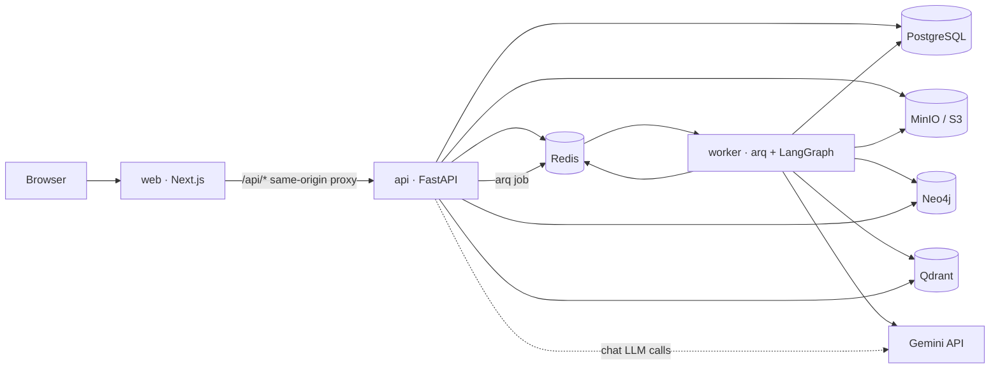
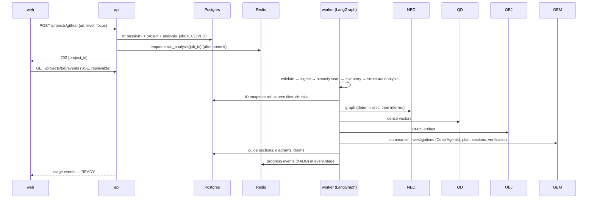

# Unfold — High-Level Design (HLD)

> Status: **implemented design** — this document describes the system as built. When code and this document disagree, fix one of them in the same change.
> Requirements: [`specs/PRD.md`](specs/PRD.md) · Engineering spec: [`specs/ESD.md`](specs/ESD.md) · Original architecture intent: [`specs/architecture.md`](specs/architecture.md), [`specs/AI_infrastructure.md`](specs/AI_infrastructure.md)
> Low-level design: [`LLD.md`](LLD.md)

---

## 1. What the system does

A user submits a **public GitHub URL or a ZIP**, a technical level (beginner / intermediate / experienced) and an optional focus instruction. Unfold statically analyses the repository (never executing it), builds a **project knowledge system** (Project IR + Neo4j graph + BM25 + Qdrant + hierarchical summaries + evidence ledger), uses LangGraph + Deep Agents over a Gemini-backed LLM Gateway to plan and write a **45–60 minute Project Guide** with diagrams and verified claims, and offers **grounded Project Chat** on top of the same knowledge. Both can be exported as PDF. No sign-in; everything expires after a TTL.

## 2. Deployable units (modular monolith + workers)



| Unit | Image | Responsibility |
|---|---|---|
| `web` | `unfold-web` | Landing, progress, guide reader, chat, export buttons. No analysis logic. Proxies `/api/*` to `api` so the session cookie is first-party. |
| `api` | `unfold-api` | Validation, sessions, project/job creation, guide/chat/diagram reads, chat answering (streamed, P0), SSE progress, export requests. Never runs analysis inline. |
| `worker` | `unfold-worker` (same Python package as api + Chromium + model cache) | Queues: `analysis` (the LangGraph pipeline), `export` (PDF), cron `maintenance` (TTL cleanup, stale-job recovery). |
| `postgres` | postgres:16 | Application truth + LangGraph checkpoints. |
| `redis` | redis:7 | arq queues, progress event streams, rate-limit windows, circuit/key health, LLM response cache, locks. |
| `neo4j` | neo4j:5 community | Relationship truth (project knowledge graph). |
| `qdrant` | qdrant | Dense vector index (one shared collection, `project_id` filter). |
| `minio` | minio | ZIP uploads, IR snapshots, BM25 index artifacts, PDFs. |

Chat runs in the **api** process (not the worker) because it is user-blocking (P0) and needs first-token latency independent of analysis queues; it uses the same library modules (retrieval, context, LLM gateway, agents) — there is one implementation of each, imported by both processes.

## 3. Logical modules (Python package `unfold`)

```text
core            config, errors (envelope + codes), logging, ids, security primitives
domain          enums (states, levels, capabilities, claim status), shared pydantic models
persistence     postgres (SQLAlchemy async + Alembic), redis, neo4j, qdrant, object_store
ingestion       github fetch (archive download), zip extraction with hard limits
security        secret detection/redaction, prompt-injection scanner, trust labelling
repo_intel      inventory + importance tiers, language/framework detection, analyzers
project_ir      ProjectIR schema + builder (stable ids, provenance)
graph           Neo4j builder (idempotent upserts), graph queries, community detection
indexing        code-aware chunker, BM25 index (bm25s), dense indexer (fastembed → Qdrant)
retrieval       planner, lexical/dense/graph/structural retrievers, RRF, reranker, expansion, sufficiency
context         Context Compiler + token budgeter
llm             LLMGateway, providers (gemini, groq), router, key pool, budgets, circuit breaker, LangChain adapter
agents          Deep Agent investigators + read-only project tools + repository backend
orchestration   LangGraph analysis graph, state, progress publisher
guide           planner, section writer, claim verifier, consistency pass
diagrams        DiagramSpec builders (deterministic from IR/graph) + Mermaid rendering
chat            chat pipeline, memory/compaction, learning state
exports         HTML templates + Chromium PDF rendering
evaluation      metrics, golden dataset runner (offline) and LLM-judged evals (online)
observability   OpenTelemetry setup, spans, metrics helpers
cleanup         TTL cleanup + stale-job recovery
api             FastAPI app, routes, dependencies, middleware, SSE
worker          arq WorkerSettings + task entrypoints
```

Dependency rule (enforced by `tests/unit/test_architecture.py`): `domain`/`core` import nothing internal except each other; provider SDKs (`google.genai`, `groq`) are imported **only** under `unfold.llm.providers`; `api` and `worker` are the only composition roots.

## 4. End-to-end analysis flow



State machine (ESD §5) is implemented verbatim in `domain.enums.JobStage` with the failure states; a stage only advances after its durable writes commit. LangGraph checkpoints (Postgres) make the pipeline resumable: a crashed or retried job resumes from the last completed node.

## 5. Key design decisions (as built)

| # | Decision | Why |
|---|---|---|
| D1 | **Gemini-only V1, provider-agnostic gateway.** 4 Gemini keys = credentials, not quota multipliers; capacity is budgeted per *model* in Redis. Fallback is across Gemini model tiers (reasoning → balanced → fast). Groq adapter exists but is disabled without keys. | User supplies 4 Gemini keys only (2026-09-22). PRD §17 forbids assuming keys multiply quota. |
| D2 | **arq** (asyncio Redis queue) for jobs; LangGraph Postgres checkpointer for durable progress. | Async-native, tiny, Redis already required; LangGraph gives node-level resume. |
| D3 | **Source files and chunks persisted in Postgres** (per project, TTL-cleaned). | Agents/chat need read access to the repo after the worker that ingested it is gone; makes evidence resolution a primary-key lookup. |
| D4 | **fastembed (ONNX, CPU)** for embeddings (`BAAI/bge-small-en-v1.5`, 384d) and cross-encoder (`Xenova/ms-marco-MiniLM-L-6-v2`); names configurable, stored in collection metadata. | No torch, small images, CPU-only per ESD §19; saves Gemini quota. |
| D5 | **tree-sitter-language-pack** for multi-language structure/imports; Python `ast` for deeper Python semantics (routes, models, calls). Grammars prefetched into the image. | Broad coverage without executing code. |
| D6 | **Deep Agents = LangChain `deepagents`**, model = `GatewayChatModel` (LangChain adapter over our gateway), filesystem = read-only `ProjectRepositoryBackend` mounted at `/repo/` + in-state scratch; no `execute`. | Keeps budgets, circuit breakers, redaction and tracing on every agent call; agents can browse the repo but never touch disk or shell. |
| D7 | **Deterministic-first verification**: claims cite evidence ids; a lexical/structural verifier checks support; only unresolved claims go to one batched LLM verification call per section. | Free-tier quota. "Do not ask a model to infer what the system can determine directly." |
| D8 | **Diagrams are DiagramSpec built from IR/graph**, never LLM-emitted SVG. Web renders React Flow; PDF renders Mermaid generated from the same spec. | ESD §22. One source of truth. |
| D9 | **Session = HttpOnly cookie** holding a random token (only its SHA-256 is stored). Every project/chat route checks ownership. | No sign-in, yet projects are not enumerable by id. |
| D10 | **SSE from Redis Streams** (`XADD`/`XREAD`, `Last-Event-ID`). | Replayable progress after reconnect; progress reflects real stages. |

## 6. Quality attributes → mechanisms

| Attribute | Mechanism |
|---|---|
| Grounded | Evidence ids on every chunk/claim; claim verifier; UNKNOWN/INFERRED labels shown in UI. |
| Secure | ZIP limits (size/count/depth/traversal/symlink/bomb ratio), GitHub host allow-list, no code execution, secret redaction before any LLM call, prompt-injection scanner + untrusted-data fencing, project-scoped tools, session ownership checks. |
| Recoverable | LangGraph checkpoints, arq retries with job heartbeat, stale-job sweeper, per-section retry, provider circuit breakers. |
| Observable | structlog JSON logs with request/project/job/trace ids; OpenTelemetry spans for API, stages, retrieval, LLM calls, agent tools; LLM usage accounting in Redis + stage metrics. |
| Evaluable | Offline golden benchmark (retrieval + IR + graph + security) as a quality gate; online DeepEval suite over Gemini (bounded). |
| Portable | All infra via env config; S3-compatible object store; no cloud SDKs in app code. |

## 7. Out of scope for this phase

GCP topology, Terraform, CI/CD workflows (explicitly deferred by the user), private repos, accounts, cross-session memory.
