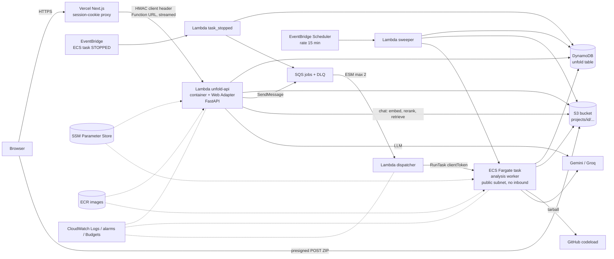

# Unfold on AWS: architecture decision (phase 4, stage B)

Status: **proposed for implementation** (2026-10-10). Authoritative inputs: `docs/infra/strategy.md`,
`six-phase-plan.md` phase 4, and the verified facts in `docs/infra/existing-architecture.md` (cited here as
"EA §n"). ADRs: `docs/adr/0010` to `0016`. Nothing in this document was applied to AWS.

## 0. Decision in one page

The candidate architecture in `strategy.md` §4 is mostly right in direction (no always-on compute, DynamoDB for
control-plane state, Fargate for heavy work, S3 for objects) and wrong in four places that the evidence settles:

1. **No API Gateway and no Step Functions.** The API is one container Lambda behind a **Lambda Function URL in
   `RESPONSE_STREAM` mode**, run with **AWS Lambda Web Adapter** (not Mangum). Jobs go SQS -> dispatcher Lambda ->
   ECS `RunTask`, reconciled by an EventBridge Scheduler sweeper.
2. **No relational database.** The code uses Postgres as a document store with parent-keyed partitions (EA §6).
   Aurora Serverless v2 at 0 ACU works as documented, but it forces a VPC for the API (NAT at about $33-41/month, or
   an unmaintained Data API driver with a 1 MiB response and 45 s limit) and adds a 15-30 s resume to the first
   request. Control-plane state moves to **one DynamoDB table (on-demand)**, bulk project content to **S3**.
3. **No Qdrant, no Neo4j, no Redis, no S3 Vectors.** Dense vectors become a per-project exact-cosine artifact in S3,
   the code graph becomes an in-memory graph built from the IR, Redis state becomes DynamoDB counters plus in-process
   state. Each replacement is gated by a measured parity test (topic 5). AuraDB Free is **rejected**: it pauses
   itself after 72 h idle and resuming "can take a few minutes to a few hours" from the console.
4. **No CloudFront, WAF, NAT, interface endpoints or Secrets Manager.** Behind the Vercel proxy an edge rate rule
   would see only Vercel addresses; Fargate runs in public subnets without inbound access; secrets live in SSM
   Parameter Store SecureString.

Estimated recurring cost (us-east-1, no credits, LLM excluded): **zero month $0.30, occasional $0.6, demo $0.8,
moderate $8.8, spike $26.7**. A single always-on `t4g.large` with the existing docker compose is **$55/month**
($39 in Mumbai) regardless of use, and a manually started/stopped one costs $2.4 stopped. Cost is therefore not the
discriminator below about $60/month; the discriminators are zero idle compute, automatic wake-up, isolating chat from
analysis, and recovery after long idle. The single-EC2 option is kept as the documented fallback (section 3).

The price of this design is code, not money: five workstreams (control-plane store, quotas/LLM coordination,
embedded dense index, in-memory graph, AWS job queue) plus import hygiene and an upload flow. Section 7 lists every
file. The riskiest item is the in-memory graph, because there is **no retrieval-quality baseline on `main`**
(EA §9: evaluation is not implemented). The plan therefore gates it on a differential test against the existing
Neo4j implementation instead of on evals.

### Topic decisions

| # | Topic | Decision |
|---|---|---|
| 1 | API front door and adapter | Lambda Function URL (`RESPONSE_STREAM`, auth NONE + application HMAC) + Lambda Web Adapter v1.1.0, container image, no API Gateway. REST API streaming (GA 2025-11-19) is the documented alternative, HTTP API is rejected |
| 2 | Upload | Presigned **POST** (size policy) browser -> S3, then a `complete` call; Vercel's 4.5 MB body limit makes this mandatory, not optional |
| 3 | Orchestration | SQS + dispatcher Lambda + `ecs:RunTask` (clientToken), ECS task-stopped event handler, 15-minute sweeper as outbox backstop; Step Functions not justified |
| 4 | Data | Option B: DynamoDB single table + S3 content; Aurora rejected with evidence; Postgres kept as dev/CI reference adapter until phase 5 |
| 5 | Retrieval stores | In-S3 numpy dense artifact (exact cosine), in-memory graph from IR; S3 Vectors, Qdrant, Neo4j (Aura Free, EC2) not adopted; gate = recall@k and graph differential tests |
| 6 | Secrets | SSM Parameter Store SecureString, standard tier, AWS-managed key; ECS `secrets` injection; Secrets Manager rejected |
| 7 | Network | No NAT, no interface endpoints; Fargate in public subnets, no inbound, egress 443; free S3 and DynamoDB gateway endpoints; Lambda outside any VPC |
| 8 | CloudFront / WAF | No. The only client IP the edge would see is Vercel's; WAF floor is $8/month |
| 9 | Quotas | Identity = session id, HMAC-verified client IP from the Vercel proxy, global buckets; DynamoDB atomic counters (fixed window key, TTL cosmetic); job caps via conditional counters healed by the sweeper |
| 10 | Worker sizing | Initial 4 vCPU / 8 GB, one concurrent task until the 6-vCPU default Fargate quota is raised, x86 until arm64 wheels are verified; benchmark matrix in §10 |
| 11 | Observability | 14-day log retention, 4 alarms, 2 budgets, one sweeper-emitted heartbeat metric; no dashboards, no X-Ray, no CloudFront logs |
| 12 | Long idle and cleanup | Expiry checked on read; sweeper deletes by partition and prefix; TTL and S3 lifecycle only as backstops; credential and image expiry handled by typed errors and an alarm |

## 1. Method, assumptions, sources

- Evidence: repository facts from EA with `path:line`; prices from the **AWS Price List bulk files**
  (`https://pricing.us-east-1.amazonaws.com/offers/v1.0/aws/<code>/current/<region>/index.json`, publication dates
  2026-09-11 to 2026-10-10) and AWS documentation, all retrieved **2026-10-10**. "Derived" = my arithmetic from a
  sourced number, 730 h/month. "UNVERIFIED" = not confirmed from an authoritative source. Nothing about latency or
  cold start was measured on AWS; those are labelled **unmeasured**.
- Regions: **us-east-1** and **ap-south-1 (Mumbai)** as the Asia region. Recommended default: **us-east-1**,
  because Vercel Functions default to `iad1` ([Vercel limits](https://vercel.com/docs/functions/limitations),
  retrieved 2026-10-10) and most prices are lower there. Region is a Terraform variable; for an India-based demo set
  the Vercel function region to `bom1` and AWS to `ap-south-1` (cost delta in the tables).
- Account model: new AWS accounts since 2025-07-15 use the credit-based Free Plan ($100 + up to $100 credits, 6
  months) instead of the 12-month free tier ([AWS free tier plans](https://docs.aws.amazon.com/awsaccountbilling/latest/aboutv2/free-tier-plans.html)).
  Cost tables **exclude credits** and include only the always-free allowances (Lambda 1 M requests + 400 000 GB-s,
  SQS 1 M requests, DynamoDB 25 GB, CloudWatch Logs 5 GB, EventBridge Scheduler 14 M).
- The AWS account is **unknown**: `aws sts get-caller-identity` returned `NoCredentials`. No other AWS call was made.
- Phase 3 items (chat with `stream=false|true`, `export` job type and `enqueue_export`, `sweep`, evals) were
  **[planned]** when this document was written. Update 2026-10-11: phase 3 is merged into this branch and its
  records (chats, messages, exports, the delete marker, typed jobs) are behind `ControlStore` on both adapters, the
  dispatcher starts `export` tasks, and the investigation engine runs in the worker (`deployment.md`, ADR 0011,
  0012, 0017). The `[planned]` marks below are kept as written; this note is their status.

Key sources (all retrieved 2026-10-10):

| Ref | URL |
|---|---|
| APIGW-HTTP | https://docs.aws.amazon.com/apigateway/latest/developerguide/http-api-quotas.html and `.../http-api-vs-rest.html` |
| APIGW-REST | https://docs.aws.amazon.com/apigateway/latest/developerguide/api-gateway-execution-service-limits-table.html |
| APIGW-STREAM | https://docs.aws.amazon.com/apigateway/latest/developerguide/response-transfer-mode.html ; https://aws.amazon.com/about-aws/whats-new/2025/11/api-gateway-response-streaming-rest-apis |
| LAMBDA-LIMITS | https://docs.aws.amazon.com/lambda/latest/dg/gettingstarted-limits.html |
| LAMBDA-STREAM | https://docs.aws.amazon.com/lambda/latest/dg/configuration-response-streaming.html |
| LAMBDA-URL | https://docs.aws.amazon.com/lambda/latest/dg/urls-configuration.html ; `.../furls-http-invoke-decision.html` |
| LAMBDA-CONC | https://docs.aws.amazon.com/lambda/latest/dg/configuration-concurrency.html |
| SNAPSTART | https://docs.aws.amazon.com/lambda/latest/dg/snapstart.html |
| LWA | https://github.com/aws/aws-lambda-web-adapter (README, `docs/guide/src/configuration/response-streaming.md`, `examples/fastapi-response-streaming`) |
| MANGUM | https://github.com/Kludex/mangum (issues #299, #341) |
| SFN | https://aws.amazon.com/step-functions/pricing/ ; https://docs.aws.amazon.com/step-functions/latest/dg/connect-ecs.html |
| SQS | https://docs.aws.amazon.com/AWSSimpleQueueService/latest/SQSDeveloperGuide/standard-queues.html ; `.../sqs-dead-letter-queues.html` ; Lambda `.../services-sqs-scaling.html` |
| ECS-RUNTASK | https://docs.aws.amazon.com/AmazonECS/latest/APIReference/API_RunTask.html |
| FARGATE | https://aws.amazon.com/fargate/pricing/ ; https://docs.aws.amazon.com/general/latest/gr/ecs-service.html ; `.../fargate-tasks-services.html` |
| AURORA-PAUSE | https://docs.aws.amazon.com/AmazonRDS/latest/AuroraUserGuide/aurora-serverless-v2-auto-pause.html |
| DATA-API | https://docs.aws.amazon.com/AmazonRDS/latest/AuroraUserGuide/data-api.limitations.html |
| DDB | https://docs.aws.amazon.com/amazondynamodb/latest/developerguide/ (ServiceQuotas, transaction-apis, howitworks-ttl) |
| S3-VECTORS | https://docs.aws.amazon.com/AmazonS3/latest/userguide/s3-vectors-limitations.html |
| AURA | https://neo4j.com/docs/aura/managing-instances/instance-actions/ ; https://neo4j.com/free-graph-database/ |
| QDRANT-LOCAL | https://raw.githubusercontent.com/qdrant/qdrant-client/master/qdrant_client/local/qdrant_local.py |
| VPC-PRICE | https://aws.amazon.com/vpc/pricing/ (NAT, endpoints, public IPv4) |
| VERCEL | https://vercel.com/docs/functions/limitations |

## 2. Candidate review (the seven questions)

Columns: **Why/feature** (why needed, which feature) - **Zero** (compute scales to zero) - **Idle** (charged while
idle) - **Code** (changes) - **Latency** - **Security/failure** - **Simpler** (alternative) - **Verdict**.

| Candidate | Why / feature | Zero | Idle | Code | Latency | Security / failure | Simpler | Verdict |
|---|---|---|---|---|---|---|---|---|
| Vercel frontend + proxy | First-party HttpOnly cookie (`frontend/.../route.ts`), hides API origin | yes | none | route adds HMAC headers, upload flow, CSP | +1 hop (iad1 default) | Function body limit **4.5 MB** (VERCEL) | S3+CloudFront static + Function URL: loses first-party cookie | **Keep** |
| API Gateway HTTP API | routing, throttling | n/a | none | none | 30 s hard cap, no streaming | no usage plans, no WAF (APIGW-HTTP) | Function URL | **Reject**: cannot carry chat streaming |
| API Gateway REST API | streaming up to 15 min since 2025-11-19, usage plans, WAF | n/a | none | `responseTransferMode: STREAM`, `/response-streaming-invocations` | +API GW hop | $3.50/M; LWA+REST streaming not verified end to end | Function URL | **Not needed**; documented alternative |
| Lambda Function URL | direct HTTPS, streaming (LAMBDA-STREAM), free | yes | none | LWA image, HMAC middleware | none added | auth NONE or AWS_IAM only; no throttle but reserved concurrency (RPS = 10 x reserved) | - | **Choose** |
| Lambda (API) | all non-job routes + chat retrieval | yes | none (no provisioned concurrency) | import hygiene, S3/Dynamo adapters | cold start **unmeasured**; image pull + imports 5-14 s observed locally for imports alone | 15 min max; 6 MB buffered request | EC2 | **Choose** |
| Mangum | ASGI adapter | - | - | - | - | does not stream (MANGUM #299, #341) | LWA | **Reject** |
| Lambda Web Adapter | streams FastAPI through Function URL (LWA example) | - | - | Dockerfile line, env vars | + extension start, **unmeasured** | extra extension process | Mangum | **Choose** |
| SQS standard + DLQ | bounded durable queue, delayed retry, backpressure (retention up to 14 d) | yes | ~0.65 M polling requests/month, inside 1 M free (derived) | `SqsJobQueue` | ms | at-least-once: handled by conditional claim | Lambda async invoke (6 h age, 2 retries, no long deferral) | **Choose** |
| Step Functions Standard | `.sync` RunTask, retries, history | yes | none | state machine, new IAM | + transitions | new accounts have reduced transition quotas (docs, number not given) | SQS+Lambda | **Not justified** (3) |
| ECS Fargate RunTask | heavy analysis (EA §4) | yes | none | `worker/dispatch.py` | image pull **unmeasured**; SOCI lazy loading documented for >250 MiB images | public IP per task; default Fargate vCPU quota **6** | EC2 | **Choose** |
| EventBridge ECS task state change | detect OOM/crash without polling | yes | none | `task_stopped` handler | s | events may duplicate; backstop sweeper | polling | **Choose** |
| EventBridge Scheduler | 15-minute sweeper | yes | within 14 M free | `sweep` | - | - | none (need a backstop) | **Choose** |
| DynamoDB on-demand | sessions, projects, jobs, events, checkpoints, quotas, LLM counters (EA §6) | yes | storage only, 25 GB free | `ControlStore` adapter (largest change) | single-digit ms, strongly consistent reads available | TTL deletes "typically within a few days" (DDB) so never trusted | Postgres | **Choose** |
| Aurora Serverless v2 min 0 ACU | keep SQLAlchemy code | **yes**, after >=300 s idle | storage + backup + any public IPv4; **needs VPC** | none to SQL, but API must be in VPC | resume ~15 s, "30 s or longer" after 24 h | blocked from pausing by any open connection, RDS Proxy; Data API: no arrays, 1 MiB, 45 s, PG up to 17.4+ | DynamoDB | **Reject** (4) |
| S3 | blobs, uploads, dense and chunk artifacts | yes | per GB | `S3BlobStore` | 10s of ms | private, SSE-S3, BPA | EBS | **Choose** |
| S3 Vectors | managed ANN, no server | yes | per GB-month | new `DenseStore` | "100 ms to subsecond" (S3-VECTORS) | filterable metadata 2 KB; no BM25 | numpy artifact | **Not justified** at <50 k vectors/project (5) |
| Qdrant (EC2/Fargate/Cloud) | dense search | no | $8-25/month floor on EC2 | none | low | stateful server | numpy artifact | **Reject** (5) |
| Neo4j AuraDB Free | graph | **no**: pauses after 72 h | free | none | resume minutes to hours | 50 k nodes/175 k rels; deleted if paused >30 d; console resume | in-memory graph | **Reject** (5) |
| Neo4j on EC2 / Fargate | graph | no | $16-25/month (t4g.medium) | none | low | JVM 2 GB minimum | in-memory graph | **Fallback only** |
| In-memory graph + numpy dense | replaces both | yes | none | ~800 lines + parity tests | load from S3 per cold project | exact | - | **Choose** |
| Local fastembed + reranker | existing retrieval quality | - | - | none | ONNX CPU | 152 MB models in image | Gemini embeddings (re-index, different quality) | **Keep** |
| SSM Parameter Store SecureString | secrets | yes | free (standard tier) | env loader | ms | 40 TPS shared | Secrets Manager $0.40/secret | **Choose** (6) |
| Secrets Manager | rotation | yes | $0.40/secret/month | same | ms | - | SSM | **Not justified** (no rotation need) |
| CloudWatch Logs/alarms/Budgets | operations | yes | free tier | none (structlog JSON exists) | - | - | none | **Choose**, minimal (11) |
| ECR | images | yes | $0.10/GB-month | lifecycle policy | pull | - | Docker Hub | **Choose** |
| CloudFront / WAF | edge security | yes | WAF $5 + $1/rule | none | + | client IP seen = Vercel | none | **Not justified** (8) |
| NAT / interface endpoints | private egress | no | $32.85-40.88/month; endpoints $7.30-9.49/AZ | none | - | - | public subnets | **Reject** (7) |
| GitHub Actions OIDC + Terraform | CI/CD | yes | none | `infra/terraform` | - | no static keys | manual | **Choose** (phase 6 apply) |

## 3. Comparison with one manually operated EC2

Baseline: one `t4g.large` (2 vCPU, 8 GiB; `t4g.medium` 4 GiB is too small: measured worker peak 3.5 GB working set
plus Neo4j, Qdrant, Postgres, Redis, EA §4.1), 30 GB gp3, public IPv4, the **existing `docker compose` and
`SubprocessJobQueue` unchanged**, Caddy for TLS, SSM Session Manager for access. Prices: t4g.large $0.0672/h
(us-east-1) and $0.0448/h (Mumbai); gp3 $0.08 and $0.0912 per GB-month; public IPv4 $0.005/h (Price List, 2026-10-09).

| Property | Single EC2 | Recommended serverless |
|---|---|---|
| Idle compute | always-on, or stopped by hand | none |
| Wake-up after idle | manual start (or a Lambda that starts it, plus changing public IP and TLS) | automatic (Lambda cold start, **unmeasured**) |
| Interactive chat vs analysis isolation | same 8 GB / 2 vCPU box; one embedding job (3.5 GB, 395 s) starves chat | separate Lambda and Fargate |
| Burst/spike | 1-2 concurrent jobs, no queue durability across instance loss | bounded queue, 1-2 tasks, durable |
| Change cost | none | five workstreams (section 7) |
| Failure domain | one instance, one AZ, EBS | regional managed services |
| Operations | patching, disk, docker, backups, cert renewal | image rebuilds, Terraform |
| Security | public host, SSH/SSM, all stores co-located with untrusted-input parser | per-role IAM, no inbound ports |

### 3.1 Monthly cost, five scenarios

Assumptions (all estimates; change them in the model, not in the conclusion): Fargate task 4 vCPU / 8 GB, x86,
**8 minutes per analysis** (the 2 424-chunk run took 7.7 min on a laptop; 33-file fixture 0.5-1 min), chat turn 10 s at
3 GB, "light" request 0.25 s at 2 GB, polling 240 requests per job, DynamoDB 600 WRU + 1 500 RRU per job, 10 WRU +
20 RRU per chat, 0.5 WRU + 3 RRU per light request, S3 30 MB resident (3-day expiry), logs 0.5 MB per job,
ECR $0.30 (about 3 GB with lifecycle, **image sizes unmeasured**), SQS idle polling 0.65 M requests (derived from 5
pollers at one long-poll per 20 s), no data transfer charge (<100 GB). Scenarios: **zero** 0 jobs; **occasional**
10 jobs, 100 chats, 3 000 light; **demo** 15 jobs, 200 chats, 5 000 light, 2 h of 1 provisioned Lambda instance;
**moderate** 300 jobs, 3 000 chats, 100 000 light; **spike** 660 jobs (300 plus one day at the 2-concurrent cap),
20 000 chats, 500 000 light. Prices: Price List files named in section 1 and the figures in the rows below. **External LLM: Gemini free tier assumed, $0; paid Gemini prices not fetched (UNVERIFIED)**. The free-tier
model limits in `core/config.py:17-24` (1 000 requests/day for flash-lite) bound a day to roughly 170-200 analyses at
5-6 calls each (derived), so the spike is quota-bound before it is money-bound.

us-east-1 (USD/month):

| Scenario | Compute (Fargate + Lambda) | Storage (S3, ECR) | DB I/O (DynamoDB) | API requests | Orchestration (SQS, EventBridge) | Networking (public IPv4) | Observability | External LLM | **Serverless total** | EC2 always-on | EC2 start/stop |
|---|---|---|---|---|---|---|---|---|---|---|---|
| Zero | 0.00 | 0.30 | 0.00 | 0.00 | 0.00 | 0.00 | 0.00 | 0 | **0.30** | 55.11 | 2.40 (0 h) |
| Occasional | 0.26 | 0.30 | 0.01 | 0.00 | 0.00 | 0.01 | 0.00 | 0 | **0.58** | 55.11 | 3.84 (20 h) |
| Demo | 0.46 | 0.31 | 0.01 | 0.00 | 0.00 | 0.01 | 0.00 | 0 | **0.78** | 55.11 | 4.42 (28 h) |
| Moderate | 7.90 | 0.39 | 0.26 | 0.00 | 0.00 | 0.20 | 0.00 | 0 | **8.75** | 55.11 | n/a (always-on) |
| Spike | 24.88 | 0.52 | 0.89 | 0.00 | 0.00 | 0.44 | 0.00 | 0 | **26.73** | 55.11 (queue-bound) | n/a |

ap-south-1:

| Scenario | Compute | Storage | DB I/O | API | Orchestration | Networking | Observability | LLM | **Serverless total** | EC2 always-on | EC2 start/stop |
|---|---|---|---|---|---|---|---|---|---|---|---|
| Zero | 0.00 | 0.30 | 0.00 | 0.00 | 0.00 | 0.00 | 0.00 | 0 | **0.30** | 39.09 | 2.74 |
| Occasional | 0.28 | 0.30 | 0.01 | 0.00 | 0.00 | 0.01 | 0.00 | 0 | **0.60** | 39.09 | 3.73 |
| Demo | 0.48 | 0.31 | 0.02 | 0.00 | 0.00 | 0.01 | 0.00 | 0 | **0.81** | 39.09 | 4.13 |
| Moderate | 8.30 | 0.39 | 0.30 | 0.00 | 0.00 | 0.20 | 0.00 | 0 | **9.19** | 39.09 | n/a |
| Spike | 25.76 | 0.52 | 1.01 | 0.00 | 0.00 | 0.44 | 0.00 | 0 | **27.73** | 39.09 | n/a |

Arm64 Fargate (if `onnxruntime`, `tokenizers`, `tree-sitter`, `asyncpg`-free wheels exist for aarch64: **UNVERIFIED**
for this lockfile) lowers moderate to $7.17 (us-east-1) and $5.54 (Mumbai). Alternatives priced but not chosen
(per month): REST API for the spike's 520 000 requests +$1.82, HTTP API +$0.52; NAT gateway $32.85 (us) / $40.88
(Mumbai) plus $0.045/$0.056 per GB; five interface endpoints in two AZs $73.00 / $94.90; WAF one ACL + 3 rules
$8.00 plus $0.60 per million requests; Aurora 0.5 ACU always-on $43.80 / $65.70 (never paused); RDS PostgreSQL
`db.t4g.micro` $11.68 / $15.33; `t4g.medium` Neo4j host $24.53 / $16.35.

Reading the tables: below about $60/month the cost differences do not decide anything. EC2 always-on loses on idle
(55 vs 0.30) and on isolation, wins only on build effort. EC2 stop/start is cheap and is a legitimate personal-use
mode, but needs a person (or a wake Lambda) and cannot serve a public share.

## 4. Decisions in detail

### 4.1 (1) API gateway type and Lambda adapter

Facts (retrieved 2026-10-10): HTTP API integration timeout 30 s fixed, 10 MB payload, **no response streaming**
(APIGW-HTTP); REST API 29 s default, **response streaming since 2025-11-19, up to 15 minutes with
`responseTransferMode: STREAM`**, no request streaming, no endpoint caching/content encoding in stream mode, 10 MB
then 2 MB/s ([APIGW-STREAM](https://docs.aws.amazon.com/apigateway/latest/developerguide/response-transfer-mode.html));
Lambda Function URL `RESPONSE_STREAM` up to the function timeout (15 min), 200 MB streamed, 6 MB buffered request,
auth NONE or AWS_IAM only; the streaming page lists a VPC restriction, so the function stays outside any VPC (LAMBDA-STREAM, LAMBDA-URL). Mangum has no streaming path (MANGUM #299,
#341); Lambda Web Adapter streams FastAPI `StreamingResponse` with `AWS_LWA_INVOKE_MODE=response_stream` and
ships an official `fastapi-response-streaming` example behind a Function URL (LWA).

Conclusion matrix (does a FastAPI NDJSON/SSE stream reach the client unbuffered):

| Front door | Mangum | Lambda Web Adapter |
|---|---|---|
| HTTP API | no (no streaming) | no (no streaming) |
| REST API (STREAM) | no (Python runtime and Mangum return one body) | **yes per docs, UNVERIFIED end to end** (no AWS-published LWA+REST sample) |
| Function URL (RESPONSE_STREAM) | no | **yes, documented example** |

Chat transport (phase 3 **[planned]**, `stream=false|true`): `stream=false` is a normal JSON response and works on
any door; `stream=true` needs a streaming door. Streaming from the browser also has to survive the Vercel proxy:
the existing route handler passes bodies through and already sets `no-transform` for `text/event-stream`
(`frontend/src/app/api/[...path]/route.ts:88-92`), and Vercel Functions allow 300 s on every plan (VERCEL). End to end
browser streaming through Vercel and a Function URL is therefore an **acceptance test that requires AWS**.

Decision: **Function URL + LWA, container image**. Reasons: the only path with a documented FastAPI streaming
example, no 29/30 s cap, free, one fewer component, and the properties API Gateway adds are not usable here
(usage plans/keys are per API key, not per user; WAF sees only Vercel). Throttling is reserved concurrency (RPS cap =
10 x reserved concurrency, LAMBDA-URL) plus the application quotas of topic 9. Residual: Function URL cannot be
fronted by WAF without CloudFront; accepted (topic 8). If a future requirement needs per-client throttling, REST API
with `responseTransferMode: STREAM` is the migration path (price $3.50/M).

Settings: function memory 3 538 MB (about 2 vCPU; tune), timeout 120 s, reserved concurrency 10 (if the account
allows; new accounts have reduced limits, number **UNVERIFIED**), `AWS_LWA_READINESS_CHECK_PATH=/health`
(`api/main.py:60`), `AWS_LWA_INVOKE_MODE=response_stream`, arm64 only after wheel verification. SnapStart for Python
container images exists (3.12+) but bills cache storage while idle (about $3.95 per GB-month, derived) and is
unsupported with `/tmp` >512 MB; **not enabled by default**.

### 4.2 (2) Upload path

Constraints: Lambda 6 MB request, Vercel Function 4.5 MB request/response body (VERCEL), `max_zip_bytes` 50 MiB
(`core/config.py:107`), 20 000 files. Therefore the API cannot carry the file and **the Vercel proxy cannot either**.
Flow: (1) `POST /projects/zip/upload-url {filename, size}`: session auth, quotas, creates the project item in state
`awaiting_upload` (expiry 30 min), returns an S3 **presigned POST** with conditions
`["content-length-range", 1, max_zip_bytes]`, exact key `projects/{project_id}/upload/source.zip`, `Content-Type
application/zip`, 10-minute expiry. (2) Browser POSTs the multipart form to S3 (bucket CORS allows the web origin;
`frontend/next.config.ts:29` `connect-src 'self'` must add the S3 origin). (3) `POST /projects/{id}/zip/complete`:
ownership check, `HeadObject` (size within limit, key matches), ranged GET of 4 bytes for the ZIP magic (existing
check `projects.py:196`), then create the job and enqueue (same `_create` path). The extraction limits and bomb
checks stay in the worker (`ingestion/archive.py:180`); presigned PUT is rejected because it cannot constrain size
(`content-length-range` exists only in POST policies; confirmed from the AWS POST policy page via search snippet only, full page not loaded). Orphans: S3 lifecycle expires `projects/` after
4 days, the sweeper deletes `awaiting_upload` projects after their expiry, and cleanup is by explicit prefix delete.
Credentials: presigned URLs are signed by the Lambda role; they die with the temporary credentials, so expiry is 10
minutes.

### 4.3 (3) Orchestration and lost-job prevention

Flow: API writes project + job (`status=queued`) in one DynamoDB transaction -> `SendMessage {type:analysis,
job_id, attempt}` -> SQS event source mapping (batch size 1, `maximum_concurrency` 2) -> dispatcher Lambda:
(a) `ecs:ListTasks` for the cluster; if running >= `MAX_CONCURRENT_TASKS` raise (message returns after visibility
timeout; the Fargate vCPU quota is the hard backstop), (b) `ecs:RunTask` with `clientToken=job_id#attempt`,
command `["analysis", job_id]`, public IP, (c) return. The task itself claims the job with a conditional update
(topic 4 row 1), so duplicate SQS delivery or duplicate tasks are harmless: the second claim sees a fresh heartbeat
and exits 0 (`orchestration/progress.py:65-72` semantics). `cleanup` messages are executed **inline** in the
dispatcher (S3 prefix delete + partition delete need no model). Exit-code contract preserved: 0 done, 75 retry.

Failure handling that today lives in `SubprocessJobQueue._supervise` (`worker/queue.py:57-88`) moves to:
1. EventBridge rule `ECS Task State Change`, `lastStatus=STOPPED`, to a `task_stopped` handler: exit 0 ignore; exit
   75 re-send with delay `min(30, 5*attempt)` s; any other code or OOM (`stopCode`, `containers[].exitCode`) re-send
   after the heartbeat guard (130 s) until `max_job_attempts`, then `fail_abandoned_job` (`worker/recovery.py:43`).
2. Sweeper (EventBridge Scheduler `rate(15 minutes)`, within the 14 M free invocations): (i) **outbox
   reconciliation**: jobs `queued` for more than 10 min with no live task are re-sent (the existing semantic of
   `requeue_incomplete_jobs`, `worker/recovery.py:23-41`, now scheduled and idempotent), (ii) `running` jobs with a
   heartbeat older than 5 min and no ECS task are re-queued, (iii) tasks older than `job_timeout + 5 min` are
   `StopTask`ed, (iv) expiry cleanup (topic 12), (v) counters healed (topic 9).
3. SQS DLQ (`maxReceiveCount` 5, retention 14 d) plus an alarm on depth >0; a job whose message reached the DLQ is
   marked `failed` with a typed dispatch error by the sweeper; no fabricated success.

Why not Step Functions: it replaces only step (b) and the stop-event handler; it does not remove the outbox gap
between commit and `StartExecution`, it does not bound concurrency (a counter is still needed), `.sync` needs
EventBridge managed rules and `events:PutRule` permissions (SFN docs), and new accounts have **reduced state
transition quotas** (docs give no number). Standard Workflows cost $0.000025/transition (us-east-1), about
$0.0001-0.0003 per job: cost is not the argument, necessity is.
Why not Lambda async invoke instead of SQS: 6-hour event age, two retries, no deferral beyond that; capacity-based
deferral needs hours to days under quota (SQS retention up to 14 days).

### 4.4 (4) Data: options A, B, C

| Option | Description | Verdict |
|---|---|---|
| A | Aurora PostgreSQL Serverless v2 (0 ACU) + DynamoDB for quotas | Rejected |
| B | **DynamoDB-focused control plane + S3 for bulk content, no relational engine** | **Chosen** |
| C | Simplest for current code: keep Postgres on a small always-on host (EC2 or RDS `db.t4g.micro`) | Documented fallback |

Aurora, verified from docs (AURORA-PAUSE, DATA-API, retrieved 2026-10-10): min 0 ACU needs Aurora PostgreSQL
>= 16.3 / 15.7 / 14.12 / 13.15; us-east-1 and ap-south-1 both list the Serverless v2 engine versions; auto-pause
`SecondsUntilAutoPause` 300 s (default and minimum) to 86 400 s; resume "typically approximately 15 seconds", "30
seconds or longer" after more than 24 h; any open user connection, RDS Proxy, logical replication or a provisioned
instance blocks pausing; storage and cluster-level charges continue while paused. Unmeasured here: actual resume.
Prices: $0.12/ACU-hour (us-east-1) and $0.18 (Mumbai), $0.10 and $0.11 per GB-month, $0.20 and $0.22 per million I/Os.
Why it still loses:

1. **Networking.** Serverless v2 needs a DB subnet group with at least 2 subnets in 2 AZs. A Lambda that talks to
   it natively must be in the VPC and then needs NAT ($32.85/$40.88 per month) or endpoints ($7.30-9.49 per AZ each)
   to reach SQS, SSM, Gemini (chat) and S3/DynamoDB (gateway endpoints are free but not SQS/SSM). A public DB violates
   strategy §5.8.
2. **Data API as the way out** has fixed limits: 1 MiB response, 45 s statement timeout, **no array parameters**,
   writer only, mandatory Secrets Manager secret ($0.40/month), supported only on PostgreSQL up to 17.4+ (**18 is not
   listed**), and the Python driver is `aurora-data-api` (sync DB-API, last release 2023) behind
   `sqlalchemy-aurora-data-api`, not asyncpg: the API's data access would be rewritten anyway. The 1 MiB limit also
   breaks `ChunkRepository.list_project` for large projects (`indexing/store.py:130`).
3. **UX.** The first request after idle waits 15-30+ s (and a connection attempt with bad credentials still wakes
   it). Polling must not wake expensive infrastructure (strategy §5.5): with DynamoDB it never does.
4. **Benefit is zero**: nothing in the code needs SQL beyond key lookups (EA §6).

Relational invariants and whether DynamoDB preserves them (single table `unfold`, keys in 4.4.1):

| # | Invariant (evidence) | DynamoDB mechanism | Preserved? |
|---|---|---|---|
| 1 | Job claim mutual exclusion (`progress.py:53,57-81`, `FOR UPDATE`) | `UpdateItem` on the job item with `ConditionExpression: status <> succeeded AND (status <> running OR heartbeat_at < :cutoff)`; sets status, `attempt = attempt + 1`, heartbeat. Single item, strongly consistent | **yes** |
| 2 | Every job mutation under the row lock (`progress.py:84-145`: stage, degraded, heartbeat, succeed, fail) | `UpdateItem` with `SET` on document paths and `ConditionExpression: owner_attempt = :attempt` (fencing token) | **yes**, and stronger (fence by attempt) |
| 3 | Session token uniqueness and lookup (`models.py:47`, `deps.py:59`) | item key `S#<token_hash>`, `PutItem` with `attribute_not_exists(PK)` | **yes** |
| 4 | `(project_id, section_key)` unique and idempotent upsert (`models.py:172`) | key `SEC#<plan_version>#<position>#<key>` under the project partition; `PutItem` is idempotent | **yes** |
| 5 | Cascade delete (`models.py:38-41`, `cleanup/service.py:33-35`) | everything of one project shares `PK=P#<id>`; `Query` + `BatchWriteItem` in a loop; idempotent and resumable | **yes** (explicit, loop-safe) |
| 6 | Progress cursor strictly increasing, replayable (`models.py:267`, `progress.py:75-85`) | `TransactWriteItems`: `Update META ADD evt_seq 1` (ReturnValues) + `Put EVT#<seq:012d>` + `ConditionCheck META.status = active`; read = `Query SK > EVT#<after>`, `ConsistentRead` | **yes**, and better: the Postgres code relies on a single publisher (`projects.py:135-137`), this serialises per project |
| 7 | Multi-row atomic replace (chunks `store.py:77-80`; plan+sections `pipeline.py:417-435`; diagrams `:565-604`) | chunks -> one S3 object (PUT is atomic); plan/diagrams -> versioned items (`SEC#<ver>#...`) switched by a single conditional update of `PLAN.version` (transactions are capped at 100 items / 4 MB, DDB quotas) | **yes**, different mechanism |
| 8 | FK integrity on insert (a progress insert for a deleted project fails: `progress.py:26-33`) | `ConditionCheck` on the project META in the same transaction; blobs written after deletion can orphan, so cleanup is re-run for tombstoned/expired projects by the sweeper | **partial**: closed by explicit sweep |
| 9 | Read-your-writes between API and worker | `ConsistentRead=true` where it matters (1 RRU per 4 KB, 2x for eventual is cheaper; default eventual) | **yes** |
| 10 | Ordering queries (`position`, `created_at DESC`, chunk path order) | sort keys; chunk ordering in memory after S3 load | **yes** |
| 11 | Session -> projects join (`sessions.py:56-62`) | GSI1 (`GSI1PK=S#<session_id>`, `GSI1SK=created_at`), latest job read from the project partition | **yes** |
| 12 | Stale/queued job scan (`recovery.py:23-41`, index status+heartbeat) | sparse GSI2 on non-terminal jobs (`GSI2PK=JOB#<status>`, `GSI2SK=heartbeat_or_created`) | **yes** |
| 13 | Expiry checked on read, not by a job (`deps.py:69-70`) | unchanged (application comparison with `expires_at`) | **yes** |
| 14 | Sliding expiry cap under lock (`sessions.py:88-98`) | conditional `UpdateItem` computing `min(now+ttl, created+max)` in the app with `ConditionExpression: expires_at = :seen` retry | **yes** |
| 15 | Item size (<400 KB) | measured max row 4.9 KB (section) and 4.5 KB (diagram); chunks live in S3 | **yes**, with a guard (reject items >300 KB) |
| 16 | JSONB whole-document read/write | native map/list attributes | **yes** |
| 17 | Alembic migrations / schema checking | none; item schemas versioned by an `sv` attribute; `alembic check` stays in CI while the Postgres adapter exists | n/a |

Costs of this choice: ~35 methods behind a `ControlStore` protocol with two adapters (SQLAlchemy kept as the
reference and for local dev until phase 5 decides deletion), DynamoDB Local in compose, and a different local test
story for transactions. DynamoDB item and request prices (on-demand, us-east-1): $0.625 per million WRU, $0.125 per
million RRU, $0.25/GB-month after 25 GB free; Mumbai $0.71, $0.1425, $0.285. PITR is off (data lives at most 3 days);
`deletion_protection_enabled = true`.

#### 4.4.1 Table design

| Entity | PK | SK | Notes |
|---|---|---|---|
| session | `S#<token_hash>` | `META` | `session_id`, `created_at`, `last_active_at`, `expires_at`, `status`, `GSI3PK="SESSIONS"`, `GSI3SK=expires_at` (expiry scan), `ttl` backstop |
| project | `P#<project_id>` | `META` | `session_id`, input fields, S3 keys, `evt_seq`, `status`, `GSI1PK=S#<session_id>`, `GSI1SK=created_at`, `ttl` |
| job | `P#<project_id>` | `JOB#<created_at>#<job_id>` | status, attempt, stage, heartbeat, stage_progress, error; sparse `GSI2PK=JOB#<status>` |
| checkpoint | `P#<project_id>` | `CKPT#<job_id>#<name>` | |
| event | `P#<project_id>` | `EVT#<seq:012d>` | |
| plan/sections/diagrams/summaries | `P#<project_id>` | `PLAN`, `SEC#<ver>#<pos>#<key>`, `DIAG#<ver>#<id>`, `SUM#<level>#<key>` | |
| quota counter | `Q#<bucket>#<subject>#<window_start>` | `C` | `count`, `ttl = window_end + 1 h` |
| LLM job usage | `U#<job_id>` | `C` | calls, input/output tokens, `ttl` 7 d |
| LLM provider window | `L#<model>#<minute>` / `L#<model>#<yyyymmdd>` | `C` | rpm, tpm, rpd; `ttl` |
| LLM key health | `K#<provider>#<idx>` | `C` | `disabled_until` |

### 4.5 (5) Retrieval stores

Facts that decide it: the graph is deterministic from the IR and used only for retrieval (EA §3.3); graph and dense
are already *optional* stages (`_optional`); the dense index holds 384-d float32 vectors, 3.7 MB for 2 424 chunks
(EA §3.4); qdrant-client local mode is exact brute force, warns above 20 000 points and holds a single-process
lock (QDRANT-LOCAL); S3 Vectors has no BM25, 2 KB filterable metadata, topK <= 10 000, $0.06/GB-month and $2.50 per
million queries, GA in both regions (S3-VECTORS); AuraDB Free: 50 000 nodes / 175 000 relationships, paused after 72
hours of inactivity, "Resuming ... can take a few minutes to a few hours", deleted if paused more than 30 days, resume
button in the console only (the API endpoint's applicability to Free is not documented) (AURA); Neo4j needs 2 vCPU /
2 GB minimum.

| Store | Idle | Quality effect | Code | Verdict |
|---|---|---|---|---|
| Qdrant on EC2 (t4g.small $12.26 / $8.18) | $8-12/month floor, shared with Neo4j needs t4g.medium $24.53 / $16.35 | unchanged | none | Fallback |
| Qdrant on Fargate per job | no persistence for chat | - | - | Reject |
| Embedded Qdrant local mode | none | exact search (>= ANN recall) | moderate, still pulls qdrant-client (+fastembed import) | Reject: numpy is simpler |
| **S3 artifact, numpy exact cosine** | none | **exact**, identical embeddings | rewrite `indexing/dense.py` (~200 lines) | **Choose** |
| S3 Vectors | $0.06/GB-month | approximate | new adapter | Not justified until >50 k vectors/project |
| AuraDB Free | free, **paused after 72 h** | unchanged | none | Reject (unattended recovery impossible) |
| Neo4j on t4g.medium | $16-25/month | unchanged | none | Fallback with ADR exception |
| **In-memory graph from IR** | none | must match Cypher results | `graph/memory.py` ~400 lines | **Choose, gated** |

Design: the worker writes `projects/{id}/dense/{model_slug}-{ANALYSIS_VERSION}.npz` (`ids`, L2-normalised float32
vectors, `subsystem`, `content_type`, `language` arrays) after embedding; chat and the worker's own section retrieval
load it (cached per process like `LexicalIndexCache`, `indexing/lexical.py:129-163`) and compute `V @ q` with the
same filters as `DenseIndex.search` (`indexing/dense.py:156-175`). The in-memory graph is built from the IR the
retriever already loads (`load_ir`, `project_ir/snapshot.py:142`) with the same node/relationship derivation as
`graph/builder.py:125-216` and implements the ten `GraphQueries` methods (`graph/queries.py:82-312`): exact /
case-insensitive / token match replaces the fulltext index; variable-length traversals are bounded BFS;
`shortestPath` is BFS with the hop cap.

**Quality gate (no eval baseline exists, EA §9, so use differential tests):**
- Dense: for every chunk-text query set derived from the 3 fixtures plus the 2 424-chunk medium input, recall@40 of
  the numpy search vs the Qdrant results must be >= 0.95 and the top-1 equal in >= 95 % of queries (exact search is
  expected to be a superset; any shortfall is a bug).
- Graph: for all ten `GraphQueries` methods over the three fixtures, results must be set-equal (neighbors, paths,
  members) and `find_entities` top-20 must overlap >= 90 %; `endpoint_flows`, `overview`, `module_dependencies`
  equal. The Neo4j implementation stays in the tree as the oracle behind `GRAPH_BACKEND=neo4j` until phase 5.
- End to end: once phase 3 evals exist, the recorded baseline must not regress; until then the guide-section
  `retrieval.done` counts (`lexical/dense/graph/structural`, EA §4.1 logs) on the fixtures must be unchanged.
- If the graph gate fails: ship `GRAPH_BACKEND=off` (already a supported degradation, recorded as
  `degraded=graph`) and report it; do **not** claim equivalence.

**Measured (phase 4 implementation, 2026-10-10, `backend/tests/integration/test_retrieval_backend_parity.py`,
real fastembed `BAAI/bge-small-en-v1.5`, real Qdrant and Neo4j, the three fixture repos analysed by the real
pipeline stages):**

| Gate | Result | Notes |
|---|---|---|
| Dense recall@40 vs Qdrant | **1.0000** over 476 queries (up to 120 chunk texts plus symbol names per fixture) | exact cosine; gate >= 0.95 |
| Dense top-1 equal | **1.0000** | gate >= 95 %; queries are chunk texts, so the top hit is the chunk itself in both: a weak top-1 test, the recall number is the informative one |
| Dense with filters (content type, subsystem, both) | recall@40 **1.0000** over 120 filtered queries | same `MatchAny` semantics; chunks without a subsystem never match a subsystem filter |
| Graph `get_node`, `neighbors` (depth 1-3, two rel-type sets, limit 5/50), `callers`, `callees`, `subsystem_members`, `overview`, `module_dependencies`, `endpoint_flows` | **identical** to Neo4j on every compared call (322 / 3 864 / 966 / 966 / 13 / 3 / 3 / 3) | model equality including order and scores |
| Graph `find_entities` (limit 20, 333 queries: exact, upper-case, single words, 4-name seed lists) | mean top-20 overlap **1.0000**, identical order on 99.7 % | exact and case-insensitive tiers are identical; the fulltext tier is a BM25 approximation of Lucene (tokenizer and idf are per project, Neo4j's are index-wide) |
| Graph `path_between` (684 pairs, 4 and 6 hops) | existence agrees on all pairs, hop count equal on all pairs with a path, every returned path validated edge by edge | Neo4j returns an arbitrary shortest path when several exist; memory returns the lexicographically smallest, so the node *sequences* can differ at equal length. A start equal to the end yields no path in both |

Not measured: the 2 424-chunk medium input (the three committed fixtures have 100-200 chunks), self-loop degree
(`overview.top_nodes` counts a recursive call once; Neo4j's undirected `COUNT {}` on a self loop was not verified),
Linux. `memory` and `artifact` are not the defaults of the code (`GRAPH_BACKEND=neo4j`, `DENSE_BACKEND=qdrant`
remain the oracles); the Terraform environments set `memory` and `artifact`. End-to-end through the pipeline
stages and `HybridRetriever` with both AWS backends is covered by `test_pipeline_and_retrieval_run_on_the_aws_backends`
(dense and graph sources contribute, nothing degraded).

### 4.6 (6) Secrets

SSM Parameter Store SecureString, standard tier (free; 10 000 parameters, 4 KB; 40 TPS shared), AWS-managed key
(`alias/aws/ssm`, no monthly key fee). Names `/unfold/<env>/{gemini_api_key_1..4,groq_api_key_1..4,github_token,
proxy_hmac_secret}`. Fargate: task definition `secrets.valueFrom` (execution role `ssm:GetParameters`), no code. Lambda:
a cold-start loader (`core/ssm_env.py`, one `GetParameters` call of <=10 names, cached) populates `Settings` before
construction; Lambda environment variables hold only parameter paths. Terraform creates **no** `aws_ssm_parameter` (phase 4 implementation finding: a refresh reads a SecureString back
with decryption, so `ignore_changes` would not keep the real value out of state, and every plan job could read
it); it only derives the names and ARNs. Values are put with `aws ssm put-parameter` (runbook,
`docs/infra/ci-additions.md`), so **no secret is in state or the repo**. Secrets Manager costs $0.40/secret/month and offers rotation nothing here
uses. Rotation procedure: put new value, `aws lambda update-function-configuration` (touch env) to force cold start;
tasks read at start. A rejected key is already disabled at runtime (EA F-4) and alarmed (topic 11).

### 4.7 (7) Network

Design: one VPC, 2 public subnets, internet gateway, **no NAT**, security group with no inbound and egress 443,
Fargate `assignPublicIp=ENABLED`, S3 and DynamoDB **gateway endpoints** (no hourly/processing charge, VPC-PRICE).
Lambda functions are not in a VPC. Public IPv4 is $0.005/h per address in use: an 8-minute job costs $0.00067.
Alternatives calculated (per month): NAT $32.85 (us) / $40.88 (Mumbai) plus $0.045 / $0.056 per GB; 5 interface
endpoints (ECR api, ECR dkr, Logs, SSM, SQS) x 2 AZ = $73.00 / $94.90 plus $0.01/GB. Both exceed the entire
serverless bill for every scenario except spike. **IPv6-only tasks are not viable**: `github.com`,
`api.github.com`, `codeload.github.com` have no AAAA records (DNS-over-HTTPS check 2026-10-10), the source of every
analysis, so DNS64/NAT64 (a NAT gateway) would be required. Residual risk: tasks can reach any host on 443; the
code only calls GitHub, Gemini/Groq, AWS (`ALLOWED_HOSTS`, `ingestion/github.py:21`) and never executes repository
code. Egress filtering would need a proxy or AWS Network Firewall (hourly per-endpoint charge, not priced here): not chosen.

### 4.8 (8) CloudFront and WAF

Costs: CloudFront pay-as-you-go always-free 1 TB and 10 M requests; flat-rate Free plan $0 with 5 WAF rules and no
overage charge (throttle behaviour UNVERIFIED); WAF web ACL $5 + $1/rule + $0.60/M requests = **$8 minimum with 3
rules**, higher than every scenario but moderate. Benefit: per-client rate rules and DDoS absorption. Here **all
browser traffic arrives from Vercel's proxy**, so an edge rule keys on Vercel egress addresses and cannot
distinguish users; real per-user control is the application quota (topic 9), which is keyed on session id and the
verified client address. No custom domain is required (Vercel serves the site; the API URL is internal). Revisit if
the browser ever calls the API origin directly or a custom API domain is needed.

### 4.9 (9) Rate limits, quotas and identity

**Identity.** The Vercel proxy computes the client address (platform header on Vercel, `client-address.ts`) and sends
`X-Unfold-Client: v1.<unix_ts>.<ip>.<hex(HMAC-SHA256(secret, ts|ip))>`; the API accepts it only if the MAC verifies
and the timestamp is within 60 s. Otherwise the key falls back to the address in the Lambda request context (exposed
by LWA as header `x-amzn-request-context`, UNVERIFIED, verify in stage C), which for any caller bypassing Vercel is a
coarse shared key. This replaces `TRUSTED_PROXY_IPS` for the AWS deployment because a Vercel -> Function URL hop has
no stable peer address (EA §5). Authenticated limits use the **session id** resolved from the cookie, never a raw
header. No API key and no client-supplied identifier is trusted. The secret is shared via SSM and a Vercel environment
variable (not an AWS key).

**Store and atomicity.** `RateLimiter.hit(key, limit, window)` -> one `UpdateItem ADD count 1` on
`Q#<key>#<window_start>` returning the new value (same semantics as the Redis `INCR`, `redis_store.py:15-20`:
counts denied attempts); `ttl = window_end + 1 h` is cosmetic, correctness comes from the window being in the key.
Job caps need exactness, so they use **conditional** counters: `ADD active 1` with `ConditionExpression active < :cap`
(a failed condition still consumes a write unit, DDB docs), released on terminal state, healed by the sweeper
recomputing from GSI2. Store failure fails closed with `StoreUnavailable` -> 503 (existing contract).

| Limit | Default | Source | Scope |
|---|---|---|---|
| Sessions per IP / hour | 20 | `core/config.py:120` (existing) | IP |
| Sessions global / hour | 500, **recommend 100** for public share | `:121` | global |
| Projects per session / hour | 10 | `:114` | session |
| Projects per IP / hour | 30 | `:122` | IP |
| Projects global / hour | 200, **recommend 40** | `:123` | global |
| Upload-url issuances per session / hour | 10 (new) | new | session |
| Chat messages per session / minute | 30 | `:115` (exists, unused) | session |
| Chat messages per session / hour | 200 (new) | new | session |
| Chat messages global / day | 2 000 (new; bound by LLM quota) | new | global |
| Exports per session / hour | 5 (new, **[planned]** feature) | new | session |
| Active jobs per session | 2 (new) | new | session |
| Queued jobs global | 20 (new, "overload" 429/503 beyond) | new | global |
| Concurrent analysis tasks | 1 initially, 2 after Fargate vCPU quota raise | `max_concurrent_jobs=2` `:118` | global |
| Archive limits | 50 MiB zip, 100 MiB tarball, 300 MiB extracted, 20 000 files, 1 MiB file, ratio 100 | `:107-113` | job |
| Chunks per project | 5 000 (new; bounds memory and the 395 s embedding at 6 chunks/s) | new, **initial, benchmark** | job |
| Job wall clock / attempts | 1 800 s / 3 | `:116-117` | job |
| LLM calls / tokens per job | 150 soft (x1.3 hard) / 1.5 M | `:95-96` | job |
| Provider day/minute caps | per model in `DEFAULT_MODEL_LIMITS` `:17-24` | existing | global |
| API function | reserved concurrency 10, timeout 120 s | new | global |

Backpressure: queue depth or active-job cap exceeded returns a typed `RateLimited`/`ProviderCapacityError` (429/503)
with a retry hint; analysis requests are never accepted beyond the cap and silently dropped.

**LLM coordination without Redis (ADR 0002 left this open).** Per job: DynamoDB `U#<job_id>` conditional `ADD` (cost
cap, persists across attempts like `usage:{job_id}`). Cross-process provider quota (chat Lambda instances and workers
share it): per-model minute and day counters in DynamoDB (fixed windows, approximate vs the sliding Redis windows,
documented). Concurrency slots, cooldown, circuit breaker and key rotation: **in-process** (a one-shot worker serves
one job; chat instances are independent). Key disablement persists as `K#...disabled_until`. Response cache and
embedding cache are dropped (cache only; `plan_guide` is the single cacheable call, `generate.py:212`).

### 4.10 (10) Worker sizing and benchmark plan

Evidence (EA §4.1, laptop, **not Fargate**): 33 files / 102 chunks: 32-37 s wall, peak working set 0.93-1.05 GB, peak
commit 1.6-2.0 GB; 175 files / 2 424 chunks: 461 s, peak working set 3.5 GB, commit 4.9 GB; embedding 6.1 chunks/s;
interpreter + imports about 9.6 s here. Memory in Fargate is a hard limit; ONNX arena growth is the suspect.
Initial setting: **4 vCPU / 8 GB**, 20 GB ephemeral (default), x86_64. Default Fargate On-Demand quota is 6 vCPU per
region, so one 4-vCPU task runs at once until the quota is raised (new accounts may start lower, auto-raised;
FARGATE). Fargate bills per second with a 1-minute minimum from image pull start (FARGATE). Valid combos: 4 vCPU
accepts 8-30 GB. Spot (up to 70 % discount, 2-minute warning, no on-demand fallback) is viable because stages are
checkpointed, but is off by default for predictable demos (dollar rate UNVERIFIED).

Benchmark plan (stage E, **local Docker with `--cpus`/`--memory` limits is allowed and needs no AWS**; the Fargate
runs are "requires AWS"):
1. Inputs: `fastapi_rag`, `express_ts_prisma`, `terraform_k8s`, the 2 424-chunk medium input, and one synthetic or
   public repo around 8 000 chunks.
2. Matrix: {2 vCPU/4 GB, 4/8, 8/16} x {x86_64, arm64} x 5 repetitions.
3. Record per run: wall, per-stage time (existing `job.stage` log lines), peak RSS from `cgroup memory.peak` printed at
   exit (small addition to `worker/run.py`), image pull time (`pullStoppedAt - pullStartedAt` from
   `DescribeTasks`), billed seconds x price, p50/p95/p99.
4. Also measure embedding variants: `batch_size`, ONNX thread count, `max_length` truncation, quantised model, and
   report the retrieval-parity effect of each (differential test above) before adopting any.
5. Deliverable: final size, `MAX_CHUNKS_PER_PROJECT`, and whether `analysis` and `export` need separate images.

Images: **three targets** from the one Dockerfile: `api` (Lambda; no playwright, no tree-sitter grammars, models
included), `worker` (analysis; grammars and models, no Chromium), `exporter` (**[planned]** Chromium, 433 MB
browser). The current `worker` target bundles Chromium (`docker/backend.Dockerfile:51`), which inflates every
analysis task's image pull; sizes are **unmeasured** (no image has been built). Pin base image digests; SOCI index
if the pull is the bottleneck (documented for images >250 MiB).

### 4.11 (11) Observability and budgets (minimum)

| Item | Setting | Cost |
|---|---|---|
| Log groups (api, dispatcher, sweeper, worker) | retention 14 days, structlog JSON already emitted | $0.50/GB ingest (us), 5 GB free |
| Alarm: DLQ visible messages > 0 | 1 | 10 alarms free |
| Alarm: dispatcher or sweeper Lambda errors >= 1 | 2 | free tier |
| Alarm: no sweeper heartbeat metric in 45 min (missing data = breaching) | 1 (sweeper writes an EMF metric, no PutMetricData call) | free tier |
| Metric filter: `llm.key_disabled`, `job.failed` | 2 | $0.30/metric if not within free tier (UNVERIFIED count) |
| AWS Budgets: monthly cost 50/80/100 % email, and a daily forecast budget | 2 action-free budgets | free (first 2 action-enabled) |
| Cost allocation tag `project=unfold`, `env` | all resources | free |
| Cost Anomaly Detection | optional | price UNVERIFIED |
| Dashboards, X-Ray, Container Insights, CloudFront logs | none | $0 |

Per-job spend telemetry: the `usage:{job_id}` equivalent (calls, tokens) is logged at job end; budgets cover AWS
only, LLM cost is bounded by quota and the per-job caps, not by a billing alarm. Budgets are alerts, not caps
(strategy §5.4); the hard stops are the quotas in topic 9.

### 4.12 (12) Long-idle recovery and cleanup

| Idle | What breaks | Design response |
|---|---|---|
| 24 h | Lambda environments gone; sessions expired by application check | cold start; frontend "waking up" state (**[planned]** phase 3); no DB resume |
| 7 d | all sessions and projects past 3-day max (`session_max_lifetime_seconds`) | sweeper already deleted partitions/prefixes; DynamoDB TTL and S3 lifecycle only caught stragglers |
| 30 d | ECR images may be pruned by lifecycle; Gemini key may be revoked; image digests drift; Neo4j n/a | ECR lifecycle keeps the last 5 tags (never `untagged` current); `PROVIDER_NOT_CONFIGURED`/`UNAUTHENTICATED` surface as typed job failure and a metric-filter alarm; a smoke script (`scripts/smoke_aws.py`, stage E) validates a fresh deploy |

Cleanup is **not** TTL-based. Order (idempotent, safe to rerun, as `cleanup/service.py:21-36`): mark project
`deleting` (conditional), delete `projects/{id}/` S3 prefix (including multipart abort), delete the project partition
by Query + BatchWrite, delete the session item when it has no remaining projects and `expires_at < now`. The
sweeper selects expired sessions through GSI3 (`SK < now`), tombstoned projects, `awaiting_upload` projects past their
expiry, and **S3 prefixes with no project item** (listing `projects/` with delimiter, bounded per run). TTL
attributes and the S3 lifecycle rule (4 days) are belt and braces only; DynamoDB deletes "typically within a few
days" and expired items still appear in reads (DDB), so reads always compare `expires_at`.

## 5. Final architecture

Request flows: sessions, reads, progress polling: Browser -> Vercel -> Function URL -> API -> DynamoDB (no worker,
no Fargate, no S3 wake). Project (GitHub): API quota counters -> transaction (project+job) -> SQS -> dispatcher ->
RunTask -> worker claims job -> checkpoints and events in DynamoDB, artifacts in S3 -> `succeeded`. ZIP: add the
presign/POST/complete steps before SQS. Chat **[planned]**: API loads IR, chunks, BM25, dense artifact and in-memory
graph from S3 (cached per instance), embeds and reranks locally, calls Gemini, streams back through Function URL,
messages stored in the project partition. Cleanup: DELETE or expiry -> SQS cleanup message or sweeper -> S3 prefix and
partition delete.

## 6. AWS resources the implementation must create (per environment dev/prod)

| # | Resource | Purpose |
|---|---|---|
| 1 | S3 bucket `unfold-<env>-<account>` + public access block, SSE-S3, bucket policy (deny non-TLS), CORS (POST/GET from web origin), lifecycle (`projects/` expire 4 d, abort multipart 1 d) | uploads, artifacts |
| 2 | DynamoDB table `unfold-<env>` (on-demand, PK/SK, GSI1-3, TTL `ttl`, deletion protection, PITR off) | control plane |
| 3 | SQS `unfold-<env>-jobs` (visibility 60 s, retention 14 d, redrive maxReceiveCount 5) + DLQ (retention 14 d) | jobs |
| 4 | ECR repositories `unfold-api`, `unfold-worker` (+ `unfold-exporter`), scan on push, lifecycle (keep last 5 tagged) | images |
| 5 | VPC, 2 public subnets, IGW, route table, SG (egress 443), gateway endpoints S3 + DynamoDB | Fargate networking |
| 6 | ECS cluster, task definitions `analysis` (4 vCPU/8 GB) and `export` **[planned]**, log groups, `secrets` from SSM | workers |
| 7 | Lambda `unfold-api` (container, Function URL RESPONSE_STREAM, reserved concurrency) | API |
| 8 | Lambda `unfold-control` (handlers: dispatcher, task_stopped, sweeper) + SQS event source mapping (batch 1, max concurrency 2) | orchestration |
| 9 | EventBridge rule (ECS Task State Change STOPPED, this cluster) and Scheduler schedule `rate(15 minutes)` + scheduler role | recovery, sweep |
| 10 | IAM roles: api, control, task, task-execution, scheduler/events; least privilege (S3 `projects/*`, table ARN, queue ARN, `ecs:RunTask` on the task family with `iam:PassRole` to two roles, SSM `/unfold/<env>/*`) | security |
| 11 | SSM parameter **names/ARNs only** (parameters are created out of band, never by Terraform: see 4.6) | secrets |
| 12 | CloudWatch log groups (14 d), 4-5 alarms, metric filters, AWS Budgets x2 | operations |
| 13 | Bootstrap (separate state): S3 state bucket (versioned, native lockfile), GitHub OIDC provider, deploy roles (`plan`, `apply`, image push) | CI/CD |

Explicitly absent: API Gateway, Step Functions, Aurora/RDS, NAT, ALB, interface endpoints, CloudFront, WAF, Secrets
Manager, KMS customer keys, ElastiCache, OpenSearch. Cost-guard policy tests (strategy §5.9) assert absence of
`aws_nat_gateway`, `aws_lb`, `aws_rds_*`, `aws_ecs_service`, provisioned concurrency, `aws_wafv2_*`.

## 7. Application changes (file level)

Workstreams are ordered; each ends with the gate named. Existing 129 backend unit tests and the integration suite
must stay green with the local adapters throughout (no loss of functionality).

| WS | Change | Files |
|---|---|---|
| 1 | Import hygiene (no behaviour change): move `ALIVE_WITHIN`, `RETRY_EXIT_CODE` to a constants module; API stops importing `orchestration.pipeline`/`worker.queue` at import; `Runtime` builds only configured stores lazily; `/ready` checks configured stores; remove `ensure_bucket()` and start-up requeue from the AWS lifespan; drop dead deps | `worker/queue.py:21`, `api/main.py:22-23,40-41,64-84`, `runtime.py:13-18,45-52`, `pyproject.toml:35,37` (+ otel instrumentation), new `orchestration/constants.py`. Gate: `import unfold.api.main` loads no fastembed/networkx/tree-sitter/qdrant/neo4j (`-X importtime`) |
| 2 | `S3BlobStore` (boto3 in threads) + presign POST | new `persistence/s3_store.py`, `ports.py` (`BlobStore.presign_upload`), `tests/unit/test_architecture.py` allow-list `boto3` |
| 3 | Upload flow | `api/routes/projects.py` (`upload-url`, `complete`; multipart route kept behind `ALLOW_DIRECT_UPLOAD`), `api/schemas.py`, `frontend/src/lib/api/endpoints.ts:35-40`, `frontend/next.config.ts:29` |
| 4 | `ControlStore`/`ChunkStore` ports with SQLAlchemy and DynamoDB adapters; refactor callers off ORM rows; Dynamo `ProgressStore` | `ports.py`, new `domain/records.py`, `persistence/postgres/control.py`, `persistence/dynamodb/{control,progress,chunks}.py`, `api/deps.py`, `api/routes/{sessions,projects,guide}.py`, `orchestration/{pipeline,progress}.py`, `worker/recovery.py`, `cleanup/service.py`, `indexing/store.py`, `runtime.py`, `core/config.py` (`PERSISTENCE_BACKEND`). Gate: one contract test suite parametrised over both adapters |
| 5 | Quotas: `DynamoRateLimiter`, `QuotaGate`; new limits | `persistence/dynamodb/limiter.py`, `ports.py`, `api/deps.py:104-118`, `core/config.py`, `api/routes/projects.py:83-88` |
| 6 | LLM coordination without Redis; remove embedding cache | `llm/budget.py`, `llm/circuit.py`, `llm/key_pool.py`, `llm/gateway.py:70-79,164-167,194-258`, `llm/cache.py`, `llm/factory.py`, `worker/run.py:72`, `indexing/dense.py:117-135`, `ADR 0002` exception list |
| 7 | Dense artifact | `indexing/dense.py` -> `DenseStore` protocol + `indexing/dense_artifact.py`, `orchestration/pipeline.py:320-328,372-383`, `retrieval/hybrid.py:131`, `retrieval/retrievers.py:108`, `cleanup/service.py:30`. Gate: recall test (4.5) |
| 8 | In-memory graph | new `graph/memory.py`, `graph/queries.py` -> `GraphQueries` protocol, `orchestration/pipeline.py:299-308,372-373`, `retrieval/hybrid.py:133`, `cleanup/service.py:31`, `GRAPH_BACKEND`. Gate: differential test (4.5) |
| 9 | AWS job queue and control handlers | new `worker/sqs_queue.py`, `worker/dispatch.py` (dispatcher, task_stopped, sweeper), `worker/factory.py`; `worker/run.py` (cgroup peak memory log, `export` **[planned]**) |
| 10 | Lambda runtime | new `docker/api.lambda.Dockerfile` target, `core/ssm_env.py`, `api/proxy_auth.py`, `api/deps.py:40-56` (`client_ip` uses verified header), `core/config.py` production guard additions (`PROXY_HMAC_SECRET` required, `TRUSTED_PROXY_IPS` unnecessary when set) |
| 11 | Images and CI | `docker/backend.Dockerfile` targets `api`, `worker`, `exporter`; `.github/workflows/ci.yml` (build images, terraform fmt/validate, policy tests) |
| 12 | Frontend proxy | `frontend/src/app/api/[...path]/route.ts` (HMAC `X-Unfold-Client`, `API_INTERNAL_URL` = Function URL), tests |
| 13 | Local emulation | `docker-compose.yml` (`amazon/dynamodb-local`, MinIO already S3-compatible incl. POST policy), moto server for SQS/ECS/EventBridge contract tests; `scripts/check.py --integration` |
| 14 | Terraform + policy tests | `infra/terraform/{bootstrap,modules/*,envs/dev,envs/prod}`, `infra/policy/` |

Order that keeps `main` shippable: 1, 2, 3, 12 (S3 path, still Postgres) -> 4, 5 (control plane) -> 6 -> 7 -> 8 ->
9, 10, 11 -> 14. Fallbacks: if 4 stalls, deploy Option C (Postgres on a t4g host) and skip 5-6; if 8 fails its gate,
`GRAPH_BACKEND=off` or a Neo4j host with an ADR exception.

## 8. Terraform layout (stage D)

`infra/terraform/bootstrap` (state bucket, OIDC provider, deploy roles), `modules/{network,storage,data,queue,
registry,api,control,worker,iam,secrets,observability}`, `envs/{dev,prod}` with pinned provider versions and a
`region` variable. Remote state in S3. Resolved in stage D: native lockfile locking (`use_lockfile`) needs Terraform >= 1.10 and the
pinned/installed version is 1.9.8, so the **bootstrap creates a DynamoDB lock table** (`unfold-tfstate-lock`, on
demand, deletion protection) and the env backends use `dynamodb_table`; move to `use_lockfile` and drop the table when
the pin reaches 1.10. `terraform apply` only by an owner-approved workflow (GitHub Environment protection), never from this run.

## 9. Acceptance tests

Runnable without AWS (stage E): Terraform fmt/validate/offline plan; policy tests with negative cases; adapter
contract tests (DynamoDB Local, MinIO presigned POST incl. size policy, moto SQS/ECS/EventBridge); duplicate delivery
(same message twice -> one claim); kill-mid-stage resume; outbox gap (commit, drop the enqueue, sweeper re-sends);
cleanup completeness across S3/DynamoDB; quota atomicity under concurrent `hit`; overload returns typed errors; dense
and graph parity; local Docker worker benchmark with CPU/memory limits; import-weight test; HMAC identity tests.

**Require a real AWS account (not marked passed until run):** Function URL + LWA streaming end to end through Vercel
(chat first token, full response); REST API variant if chosen; cold start p50/p95/p99 of the API container image;
Fargate task start (pull) latency and arm64 viability; actual RunTask quota/limits in the new account (6 vCPU?);
Lambda reserved concurrency feasibility; `clientToken` idempotency; EventBridge STOPPED event handling for OOM;
SSM loader and ECS secrets injection; S3 presigned POST from a browser with CORS and CSP; DynamoDB TTL behaviour is
not asserted (never relied on); budget alarm delivery; idle check (no tasks, no NAT/ALB); 24 h / 7 d recovery;
Cost Explorer vs model after 24-48 h.

## 10. Open risks and UNVERIFIED items

| Risk | Impact | Mitigation |
|---|---|---|
| No retrieval-quality baseline exists on `main` (EA §9) | cannot prove "quality preserved" with evals | differential tests (4.5), rerun with phase 3 evals when they land |
| Native crash in tree-sitter on TS input (EA F-2) | worker dies, retries repeat the crash | **root-caused and fixed in implementation (audit commit)**: py-tree-sitter 0.26.0 corrupts memory (reproduces with the unchanged extractor on 2 of 62 frontend files; 0.25.0-0.25.2 pass 62/62 and the pair 0.25.2 + language-pack 1.20.0 is what runs now); pinned `tree-sitter>=0.25.2,<0.26`. Linux behaviour of 0.26.0 was not measured, so the pin stays until a Linux image run shows otherwise; per-file process isolation was not added |
| Embedding throughput (6.1 chunks/s here) and 3.5 GB peak | long jobs, OOM | chunk cap, benchmark matrix, size by data not guess |
| LWA + REST/Function URL streaming through Vercel unverified end to end | chat `stream=true` may buffer | acceptance test; `stream=false` always works |
| New-account quotas (Lambda concurrency, Fargate 6 vCPU, SFN transitions) | cannot reserve concurrency or run 2 tasks | numbers not documented: check at account creation, design needs only 1 task and works without reserved concurrency |
| Python container cold start unmeasured; imports alone were 5.6-14 s on this laptop | first request latency | WS1 import hygiene, measure, SnapStart option (cost noted) |
| aarch64 wheels for onnxruntime/tokenizers/tree-sitter pack unverified | arm64 saving not available | x86 default, check lockfile in stage C |
| Gemini free-tier limits and terms for public use not fetched | LLM outage or data-use policy | provider fallback exists (Groq); read terms before sharing publicly |
| In-memory graph parity | retrieval differences | gate; `GRAPH_BACKEND=off` fallback is explicit |
| Function URL exposed without edge protection | cost abuse by direct calls | reserved concurrency, per-IP/global quotas, HMAC for trusted identity, budgets |
| Public IP on Fargate tasks, open egress | exfiltration if a parser bug were exploited | no inbound, never execute repo code, minimal task role; Network Firewall rejected on cost |
| DynamoDB item and access-pattern rewrite is the largest change | schedule | staged adapters, contract tests, Postgres retained as oracle |
| SSM standard tier 40 TPS shared | throttling at mass cold start | cache, single `GetParameters`, retry with jitter |
| Aura/Qdrant/S3 Vectors figures partly from vendor pages summaries | decision margins | none of the chosen path depends on them |
