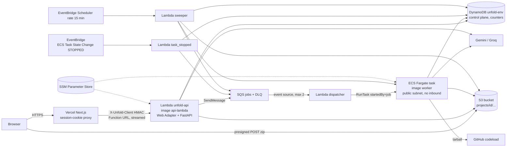

# Unfold on AWS: what is deployed, how, and with what settings

Status: implemented and tested **locally only** (2026-10-10). Nothing in this document was applied to AWS. Choices
and their evidence: `architecture-decision.md`, ADRs 0010 to 0016. Measured numbers and the list of tests that need a
real account: `operations.md`. Costs: `cost.md`.

## 1. Architecture

Nothing runs while idle: no ECS service, no NAT gateway, no load balancer, no provisioned concurrency, no database
instance. Policy tests assert this (section 7).

## 2. Request and data flows

| Flow | Path |
|---|---|
| Session, reads, progress polling | Browser -> Vercel -> Function URL -> API Lambda -> DynamoDB. No queue, no task, no S3 wake-up. |
| Project from a GitHub URL | quota counters -> one DynamoDB transaction (project + job + pointer + cap counters) -> progress event -> SQS -> dispatcher -> `RunTask` -> task claims the job -> stages checkpointed in DynamoDB, artifacts in S3 -> `succeeded`. |
| ZIP upload | `POST /projects/zip/upload-url` (limits, project record without job, presigned POST for the exact key, 50 MiB policy) -> browser POSTs to S3 -> `POST /projects/{id}/zip/complete` (stat, magic bytes, delete on failure, job + enqueue). Idempotent. |
| Task ends | EventBridge `STOPPED` -> `task_stopped`: exit 0 ignore, 75 re-send with backoff, other codes re-send after the heartbeat guard until `MAX_JOB_ATTEMPTS`, then the job is failed with a typed error. Every stop also hands the freed slot to the oldest waiting job. |
| Lost enqueue (commit without send) | The sweeper re-sends jobs `queued` for more than 10 minutes and jobs `running` with a heartbeat older than 5 minutes. Duplicates are harmless (claim). |
| Delete / expiry | `DELETE` hides the project at once (expiry set to now) and sends `cleanup`; the dispatcher deletes S3 prefix, progress events and the project partition. The sweeper does the same for expired projects and removes sessions without projects. TTL and the S3 lifecycle rule are backstops only. |

## 3. Resources per environment (`infra/terraform/envs/{dev,prod}`)

| Module | Resources | Purpose |
|---|---|---|
| `storage` | S3 bucket, public access block, SSE-S3, TLS-only policy, CORS (POST/GET from the web origin), lifecycle (`projects/` 4 d, abort multipart 1 d) | uploads and artifacts (IR, BM25, dense, chunks) |
| `data` | DynamoDB table `unfold-<env>` (on demand, PK/SK, GSI1-3, TTL attr, deletion protection, PITR off) | control plane, counters, LLM windows |
| `queue` | SQS jobs queue + DLQ (redrive 5, 14 d), TLS-only policies | durable bounded dispatch |
| `registry` | ECR repositories api/worker/exporter (immutable tags, scan on push, lifecycle) | images |
| `network` | VPC, 2 public subnets, IGW, route table, worker SG (no inbound, egress 443), S3 + DynamoDB gateway endpoints | Fargate networking without NAT |
| `worker` | ECS cluster, task definitions `analysis` (and `export` when enabled) | heavy work; no ECS service |
| `api` | Lambda `unfold-<env>-api` (image, Function URL `RESPONSE_STREAM`, reserved concurrency) | API |
| `control` | Lambdas dispatcher, task_stopped, sweeper (worker image, `awslambdaric` entry point), SQS event source (batch 1, max concurrency 2), EventBridge rule, Scheduler schedule + role | orchestration and recovery |
| `iam` | roles api, worker-task, task-execution, dispatcher (+ scheduler role in `control`), all under a permissions boundary, no wildcard actions | least privilege |
| `secrets` | names and ARNs only (no `aws_ssm_parameter`) | secrets never enter state |
| `observability` | log groups (14 d), 4 alarms, 2 metric filters, SNS topic, 2 budgets | operations |
| `bootstrap` (own state) | state bucket, lock table, GitHub OIDC provider, plan/apply/images roles, runtime boundary | CI without keys |

Provider `hashicorp/aws ~> 6.68` (6.x is required for the Function URL `lambda:InvokeFunction` permission with
`invoked_via_function_url`), Terraform 1.9.8, lock files committed. All resources carry `project`, `env`,
`managed_by` tags (provider default tags).

## 4. Images (`docker/backend.Dockerfile`, one file, pinned base digests)

| Target | Contains | Runs as |
|---|---|---|
| `api-lambda` | core + `ai` group (bm25s, fastembed, google-genai), retrieval models, Lambda Web Adapter 1.1.0 | API Lambda (`unfold.api.aws:create_aws_app`) |
| `worker` | core + `ai` + `analysis` + `lambda-runtime`, models, tree-sitter grammars | Fargate `analysis`/`cleanup`; control Lambdas (entry point overridden) |
| `exporter` | worker + Chromium | PDF export task (phase 3) |
| `api` | core + `ai` + `local` | local stack development only; not pushed |

## 5. Environment variables and secrets

Non-secret settings are Lambda/task environment variables written by Terraform (`envs/*/main.tf` `app_env`).

| Variable | Set by | Meaning |
|---|---|---|
| `PERSISTENCE_BACKEND=dynamodb` | Terraform | AWS profile: DynamoDB control store, S3 chunks/blobs, SQS, DynamoDB counters |
| `DENSE_BACKEND=artifact`, `GRAPH_BACKEND=memory` | Terraform | embedded retrieval stores (ADR 0013) |
| `DYNAMODB_TABLE`, `OBJECT_STORE_BUCKET`, `JOBS_QUEUE_URL` | Terraform | resource names |
| `ECS_CLUSTER_ARN`, `TASK_DEFINITION_ANALYSIS`, `SUBNET_IDS`, `SECURITY_GROUP_IDS` | Terraform (control Lambdas) | `RunTask` parameters |
| `SSM_PATH_PREFIX=/unfold/<env>/` | Terraform | where the API loads secrets from |
| `ALLOW_DIRECT_UPLOAD=false` | Terraform | multipart upload route off (6 MB Lambda request limit) |
| `APP_ENV=production`, `COOKIE_SECURE=true`, `PUBLIC_WEB_ORIGIN` | Terraform | production guard refuses unsafe values |
| `MAX_*`, `JOB_TIMEOUT_SECONDS`, `ANALYSIS_LLM_*` | Terraform `limits` object | section 6 |
| `AWS_ENDPOINT_URL` | never on AWS | emulators only; the production guard refuses it |

Secrets live in SSM Parameter Store (SecureString, AWS-managed key) under `/unfold/<env>/`: `gemini_api_key_1..4`,
`groq_api_key_1..4`, `github_token`, `proxy_hmac_secret`. The API Lambda reads the path once at cold start
(`persistence/ssm_secrets.py`, allow-listed names only, existing environment variables win). Fargate tasks get the
names in `worker_secret_names` through ECS `secrets`. Terraform does not manage the parameters (a refresh would copy
decrypted values into state); the runbook is in `ci-additions.md` section 5. The Vercel project holds the same
`proxy_hmac_secret` value as an environment variable.

## 6. Limits (configuration, not code; defaults of `var.limits`)

| Limit | Default | Enforced by |
|---|---|---|
| sessions per IP / global per hour | 20 / 100 | DynamoDB fixed-window counter (`RateLimited` 429) |
| projects per session / IP / global per hour | 10 / 30 / 40 | same |
| upload URLs per session per hour | 10 | same |
| active jobs per session | 2 | counter in the job transaction, healed from the job records |
| queued jobs globally | 20 | same |
| concurrent analysis tasks | 1 (2 after the Fargate vCPU quota is raised) | dispatcher (`ListTasks`), Fargate quota |
| ZIP / tarball / extracted | 50 MiB / 100 MiB / 300 MiB, 20 000 files, 1 MiB per file, ratio 100 | presigned policy, `inspect_upload`, worker extraction |
| chunks per project | 5 000 | setting present; enforcement in chunking is part of the engine work |
| job wall clock / attempts | 1 800 s / 3 | worker watchdog, sweeper `StopTask`, claim attempt counter |
| LLM calls / tokens per job | 150 (hard 195) / 1.5 M | conditional counter per job |
| provider minute/day windows | per model (`DEFAULT_MODEL_LIMITS`) | DynamoDB fixed windows (approximate) + in-process slots |
| API reserved concurrency / timeout | 5 / 120 s | Lambda |
| chat per session per minute / hour, global per day; exports per session per hour | 30 / 200 / 2 000; 5 | settings present, consumed by the phase 3 routes |

Rejections are typed (`RATE_LIMITED` 429, `STORE_UNAVAILABLE` 503, `QUEUE_UNAVAILABLE` 503); a store outage fails
closed.

## 7. Cost guard and security checks (`infra/policy`, run in CI)

Rules evaluated on the offline plan of `bootstrap`, `envs/dev` and `envs/prod`, each with a violating fixture that
must trip exactly that rule: no `aws_ecs_service`, `aws_nat_gateway`, `aws_lb`/`aws_alb`, relational database,
interface VPC endpoint, WAF, provisioned concurrency; no wildcard IAM actions; no static access keys; S3 private and
encrypted; security groups closed; SQS redrive present; log retention set; ECR lifecycle present; DynamoDB protected;
no secrets in state; Lambdas outside a VPC. `uv run --directory backend pytest ../infra/policy`.

## 8. Deploy and rollback

First deploy (owner authorization required, none granted so far): `ci-additions.md` section 5.

1. Bootstrap with a human principal; set the GitHub repository variables from its outputs.
2. `aws ssm put-parameter ...` for the secrets.
3. CI pushes `api-lambda`, `worker`, `exporter` tagged with the git SHA (immutable tags).
4. `terraform apply` of `envs/dev` with the three image URIs; run the smoke checks (`operations.md` section 6).
5. Repeat for prod from the protected GitHub Environment.

Rollback: re-apply with the previous image tags (the last 5 are kept); data-plane changes are additive (items carry
no schema migration; a record version attribute guards writes). A bad Terraform change: `git revert` and apply, or
restore the state file version from the versioned state bucket. `terraform destroy` of an environment needs
`allow_destroy_data=true` first (deletion protection, non-empty bucket, ECR images). Vercel has its own instant
rollback. The single-EC2 fallback of `architecture-decision.md` section 3 remains available.
