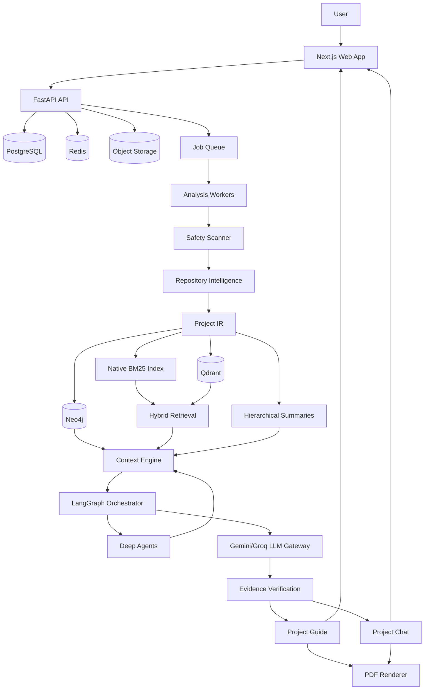
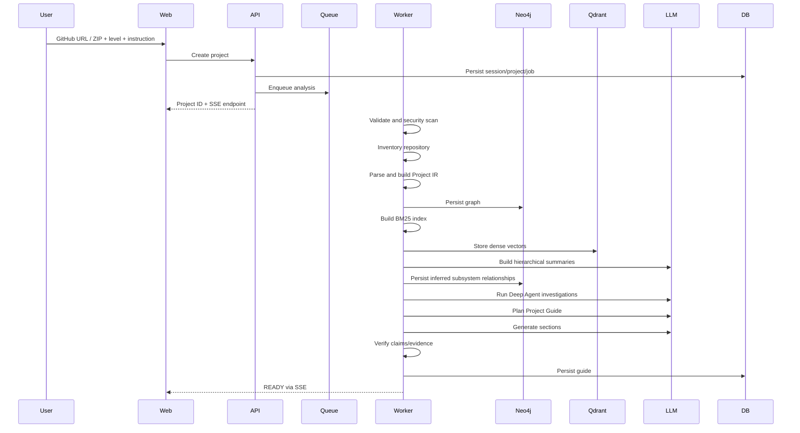
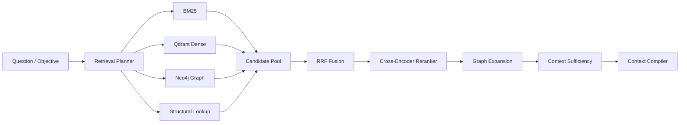
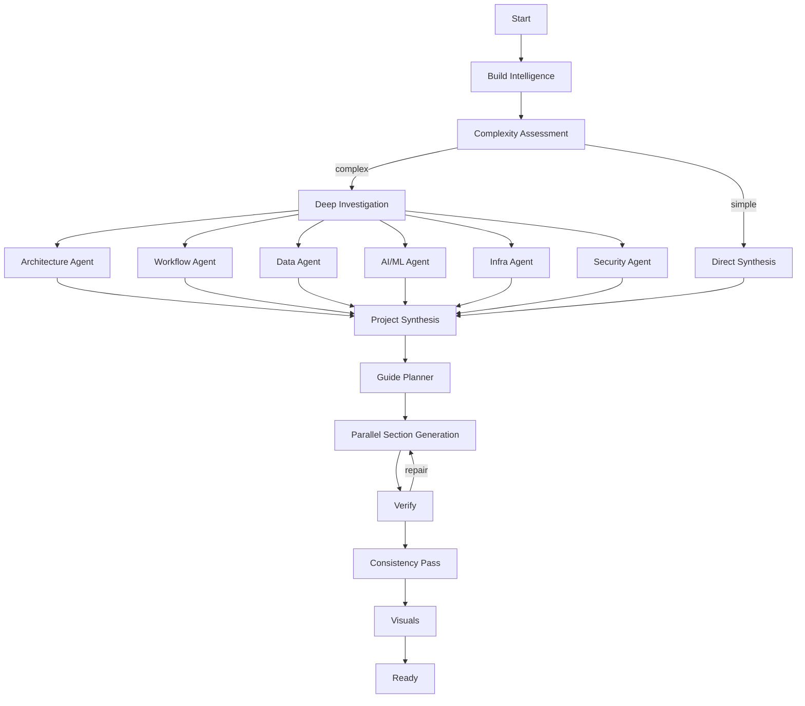
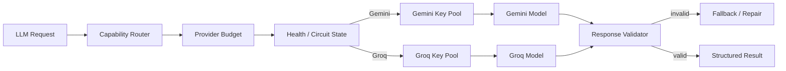
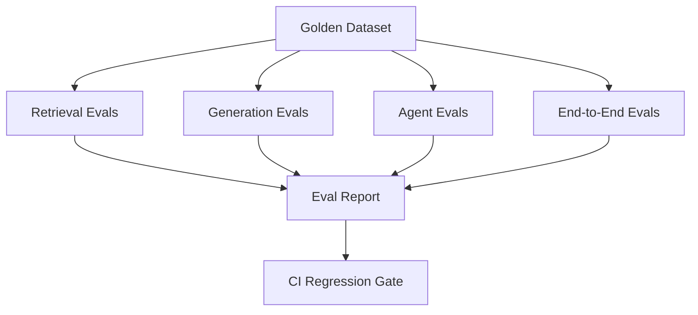
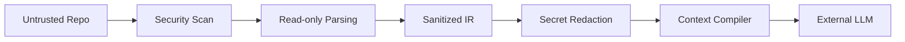

# Unfold — Architecture

> **Caption:** Prepare your project.  
> **Document status:** Draft v1.0  
> **Scope:** High-Level Design (HLD) + Low-Level Design (LLD)  
> **Deployment:** Cloud-portable; final GCP topology intentionally deferred

---

# 1. Architectural Thesis

Unfold is not a normal RAG application.

Its core architecture is:

> **Codebase understanding → structured project model → graph intelligence → hybrid retrieval → context engineering → agentic synthesis → verified learning output**

The central technical object is not a vector chunk. It is a **project knowledge system** composed of:

1. a deterministic Project IR,
2. a Neo4j code/project knowledge graph,
3. a lexical BM25 index,
4. a dense vector index in Qdrant,
5. hierarchical summaries,
6. evidence/provenance records,
7. agent-produced structured findings,
8. generated Project Guide state.

The architecture should maximize understanding quality while keeping the system inspectable, testable, and deployable.

---

# 2. High-Level Architecture



---

# 3. Architectural Boundaries

## 3.1 Frontend boundary
The frontend:
- submits repository input,
- displays progress,
- renders guide,
- renders diagrams,
- runs chat UI,
- requests exports.

The frontend must not contain project-analysis logic.

## 3.2 API boundary
The API:
- validates requests,
- creates sessions/projects/jobs,
- serves guide/chat state,
- publishes events,
- manages export requests.

Heavy analysis never runs synchronously in API request handlers.

## 3.3 Worker boundary
Workers own:
- ingestion,
- scanning,
- parsing,
- graph construction,
- indexing,
- summarization,
- Deep Agent work,
- guide generation,
- evaluation hooks,
- PDF generation.

## 3.4 AI boundary
All model calls go through the LLM Gateway.
No module calls Gemini or Groq SDKs directly.

## 3.5 Storage boundaries

```text
PostgreSQL → application truth
Neo4j      → relationship truth
Qdrant     → dense semantic index
BM25       → lexical index
Redis      → ephemeral coordination/cache
Object     → blobs/artifacts/index snapshots
```

---

# 4. Why Multiple Data Stores Are Justified

## PostgreSQL
Best fit for:
- transactional state,
- jobs,
- sessions,
- guide records,
- chat metadata,
- expiry.

## Neo4j
Best fit for:
- software relationships,
- traversal,
- dependency paths,
- call paths,
- component topology,
- architecture queries.

## Qdrant
Best fit for:
- project-scoped dense similarity search,
- metadata-filtered vector retrieval,
- high-recall semantic candidate generation.

## Native BM25
Best fit for:
- exact identifiers,
- filenames,
- symbols,
- framework terms,
- config keys,
- lexical relevance.

## Redis
Best fit for:
- queues,
- recent chat memory,
- transient progress,
- caching,
- throttling,
- distributed locks.

## Object storage
Best fit for:
- ZIPs,
- generated PDFs,
- diagram assets,
- Project IR snapshots,
- lexical index files.

No store should be used merely because it is available.

---

# 5. End-to-End Project Analysis Flow



---

# 6. Project Intelligence Architecture

## 6.1 Repository Intelligence Layer

Responsibilities:
- file inventory,
- language detection,
- framework detection,
- manifest parsing,
- AST parsing,
- symbol extraction,
- route extraction,
- data model extraction,
- dependency extraction,
- infrastructure extraction.

### Inputs
- local temporary repository path.

### Outputs
- deterministic `ProjectIR`.

### Invariant
No source project execution.

---

# 7. Project IR Architecture

Project IR must be:
- language-agnostic,
- serializable,
- versioned,
- evidence-aware,
- deterministic where possible.

Example:

```json
{
  "project": {
    "id": "p_123",
    "name": "example",
    "commit": "abc123"
  },
  "modules": [...],
  "symbols": [...],
  "endpoints": [...],
  "services": [...],
  "data_stores": [...],
  "infrastructure": [...],
  "relationships": [...],
  "evidence": [...]
}
```

## 7.1 Stable IDs

Use content/context-derived IDs:

```text
project_id + entity_type + normalized_path + qualified_name
```

Do not use random UUIDs for deterministic graph entities if stable recomputation is useful.

---

# 8. Knowledge Graph Architecture

## 8.1 Graph layers

### Layer 0 — Project
- Project

### Layer 1 — Subsystems
- Frontend
- Backend
- Auth
- Retrieval
- AI
- Data
- Infrastructure
- etc.

### Layer 2 — Components
- services,
- APIs,
- workers,
- models,
- queues,
- pipelines.

### Layer 3 — Implementation
- files,
- classes,
- functions,
- routes,
- schemas.

### Layer 4 — Evidence
- source spans,
- docs,
- configs,
- tests.

This hierarchy allows:
- broad guide reasoning at L0–L2,
- precise chat reasoning at L2–L4.

## 8.2 Graph construction strategy

```text
Deterministic graph
       +
Semantic inference
       =
Project Knowledge Graph
```

Deterministic edges:
- imports,
- calls,
- contains,
- route-handler links,
- schema/table links,
- dependency links.

Inferred edges:
- component belongs to subsystem,
- conceptual responsibility,
- inferred workflow relationship,
- inferred architectural role.

Inferred edges require confidence/provenance.

---

# 9. Graph Query Patterns

Examples:

### Find neighbors
```cypher
MATCH (n {project_id: $project_id, id: $node_id})-[r]-(m)
RETURN n, r, m
LIMIT $limit
```

### Trace API to persistence
```cypher
MATCH p=(e:APIEndpoint {project_id:$project_id})
    -[*1..6]->
    (t:Table {project_id:$project_id})
RETURN p
```

### Find callers
```cypher
MATCH (caller)-[:CALLS]->(target {project_id:$project_id, id:$symbol_id})
RETURN caller
```

### Find subsystem implementation
```cypher
MATCH (s:Subsystem {project_id:$project_id, id:$subsystem_id})
      <-[:PART_OF*1..3]-(x)
RETURN x
```

All queries must include project scope.

---

# 10. Retrieval Architecture



---

# 11. Retrieval Modes

## 11.1 Guide mode
Goal:
- coverage,
- diversity,
- subsystem completeness.

Uses:
- broad multi-query retrieval,
- subsystem summaries,
- graph communities,
- architecture nodes,
- evidence sampling.

## 11.2 Chat mode
Goal:
- precision,
- direct answerability.

Uses:
- narrow query plan,
- precise symbols,
- graph expansion,
- iterative retrieval.

## 11.3 Deep investigation mode
Goal:
- reconstruct complex behavior.

Uses:
- Deep Agent,
- repeated tool use,
- targeted graph traversal,
- multiple retrieval rounds,
- explicit evidence synthesis.

---

# 12. Context Engineering Architecture

Context must be compiled, not concatenated.

```text
Global project summary
      +
Relevant subsystem summaries
      +
Graph paths
      +
High-confidence evidence
      +
Relevant source chunks
      +
Known/inferred facts
      +
User level
      +
User objective
      =
Compiled Context
```

## 12.1 Token budgeting

A context budgeter allocates tokens by priority:

1. objective and instructions,
2. verified architecture facts,
3. relevant subsystem summary,
4. evidence,
5. graph paths,
6. selected source,
7. low-priority supplemental context.

If over budget:
- remove duplicates,
- compress low-priority material,
- use parent summary instead of raw child chunks,
- retain evidence IDs.

---

# 13. LangGraph HLD

LangGraph controls long-running AI state.



---

# 14. Deep Agent Architecture

Deep Agents are not autonomous products.
They are bounded investigation units.

Each Deep Agent receives:
- a narrow objective,
- project ID,
- tool allow-list,
- call budget,
- context budget,
- output schema.

Example:

```python
class InvestigationTask(BaseModel):
    project_id: str
    objective: str
    subsystem_ids: list[str]
    max_tool_calls: int
    max_subagents: int
```

Required output:

```python
class InvestigationFinding(BaseModel):
    summary: str
    facts: list[ClaimRecord]
    workflows: list[WorkflowFinding]
    components: list[str]
    evidence_ids: list[str]
    uncertainties: list[str]
```

Deep Agents may spawn subagents for isolated subtasks, but all outputs return as structured findings.

---

# 15. Native AI Tooling

Agents use native internal tools, not MCP.

Examples:

```text
search_lexical
search_dense
search_hybrid
query_graph
find_symbol
find_references
trace_call_path
read_file
read_symbol
inspect_manifest
get_subsystem
get_project_summary
get_endpoint
get_schema
```

Tools must:
- enforce project scope,
- enforce output size,
- emit tracing,
- return evidence IDs,
- never expose arbitrary filesystem access outside project sandbox.

---

# 16. LLM Routing Architecture



Routing factors:
- required capability,
- context size,
- latency,
- current provider health,
- rate limits,
- model availability,
- output schema reliability,
- task criticality.

---

# 17. Database LLD

## 17.1 Transaction boundaries

Examples:

### Create project
Transaction:
- create session if needed,
- create project,
- create analysis job,
- commit,
- enqueue after commit.

### Complete guide section
Transaction:
- persist generated content,
- persist quality scores,
- mark section verified,
- update guide progress.

Use outbox/event pattern if enqueue consistency becomes a problem.

---

# 18. Qdrant LLD

Collection strategy:

Option A:
- one shared collection with `project_id` filter.

Preferred initially for operational simplicity.

Payload indexes:
- project_id,
- content_type,
- subsystem_id,
- language,
- symbol_type,
- importance.

Vector dimension determined by configured embedding model.

If embedding model changes incompatibly:
- create new versioned collection,
- reindex.

---

# 19. BM25 LLD

`LexicalIndex` interface:

```python
class LexicalIndex(Protocol):
    def build(self, project_id: str, docs: list[IndexDocument]) -> IndexManifest: ...
    def search(self, project_id: str, query: str, k: int) -> list[RetrievedItem]: ...
    def delete(self, project_id: str) -> None: ...
```

Persist:
- tokenized corpus,
- metadata mapping,
- BM25 index arrays,
- version manifest.

Optimize exact code identifiers:
- preserve snake_case,
- preserve camelCase decomposition,
- index full qualified symbols,
- index path tokens.

---

# 20. Fusion LLD

```python
def reciprocal_rank_fusion(
    rankings: list[list[RetrievedItem]],
    k: int,
    weights: list[float] | None = None
) -> list[FusedItem]:
    ...
```

Requirements:
- deterministic tie-breaking,
- source attribution,
- configurable weights,
- normalized candidate identity,
- unit tests with known rankings.

Future:
- query-class-specific weights,
- learned fusion.

---

# 21. Reranker LLD

Reranker receives fused candidates.

Input:
- query,
- candidate text representation,
- optional metadata.

Output:
- reranker score,
- final rank.

Use local model where practical to protect free-tier LLM quotas.

Batch candidates.

---

# 22. Context Sufficiency

Before generation:

```python
class SufficiencyResult(BaseModel):
    sufficient: bool
    missing_aspects: list[str]
    confidence: float
```

Evaluation inputs:
- objective,
- retrieved evidence,
- expected evidence types.

If insufficient:
- create follow-up retrieval plan,
- optionally invoke Deep Agent.

Maximum rounds are bounded.

---

# 23. Guide Architecture

Guide is stored as structured content, not raw Markdown only.

```json
{
  "title": "...",
  "blocks": [
    {"type": "paragraph", "...": "..."},
    {"type": "callout", "...": "..."},
    {"type": "diagram", "diagram_id": "..."},
    {"type": "code", "...": "..."},
    {"type": "qa", "...": "..."}
  ]
}
```

Benefits:
- rich web rendering,
- PDF reuse,
- interactive controls,
- future export formats.

---

# 24. Chat Architecture

Chat response event stream:

```text
chat.started
retrieval.started
retrieval.completed
agent.started
agent.tool
agent.completed
response.delta
response.evidence
response.completed
```

The UI may hide internal reasoning while still showing useful progress.

Do not expose private model chain-of-thought.

---

# 25. PDF Architecture

```text
Structured Guide
   ↓
HTML Template
   ↓
CSS Print Layout
   ↓
Headless Chromium
   ↓
PDF
```

Use the same structured content as the web guide.
Do not maintain separate content generation for PDF.

---

# 26. Evaluation Architecture



Evaluation categories:
- deterministic metrics,
- LLM-judge metrics,
- trajectory metrics,
- human review.

LLM-judge metrics are never the only quality signal.

---

# 27. Observability Architecture

Use OpenTelemetry SDK in:
- FastAPI,
- worker,
- retrieval,
- Neo4j,
- Qdrant,
- LLM Gateway,
- agents,
- export.

Export destination remains configurable.

Trace attributes:
- project_id,
- stage,
- provider,
- model,
- retrieval mode,
- query intent,
- evidence count,
- agent type,
- tool count,
- success/failure.

---

# 28. Scalability Strategy

## API
Stateless; horizontal scale.

## Workers
Horizontal by queue:
- ingestion,
- parsing,
- indexing,
- AI analysis,
- export.

## Neo4j
Project-scoped graph queries.
Avoid unrestricted variable-depth traversal.

## Qdrant
Shared collection + project filter initially.

## LLM
Backpressure at router.
No unbounded parallel fanout.

## Deep Agents
Per-project concurrency limit.

---

# 29. Large Repository Strategy

Large repositories require a different execution plan.

```text
Inventory
  ↓
Importance scoring
  ↓
Architecture-critical parse
  ↓
Broad Project IR
  ↓
Subsystem discovery
  ↓
Hierarchical summaries
  ↓
Targeted deep investigation per subsystem
  ↓
Guide planning
```

Do not:
- embed every generated/vendor file,
- summarize every function,
- send whole repo to LLM.

Use:
- deterministic structure,
- hierarchy,
- graph communities,
- selective retrieval,
- agent decomposition.

---

# 30. Failure and Recovery

## Provider 429
- honor cooldown,
- provider-level backpressure,
- alternate provider/model where valid,
- persist state,
- resume.

## Neo4j failure
- retry transaction,
- do not advance graph-complete stage until consistency verified.

## Qdrant failure
- retry batch,
- track indexing manifest.

## worker crash
- job heartbeat expires,
- retry from last durable stage.

## section generation failure
- retry section only,
- do not regenerate entire guide.

---

# 31. Security Architecture



Key invariants:
- repository never controls system prompt,
- repository code never executes,
- secret-like content is redacted,
- agents have no unrestricted shell,
- all project access is scoped by project ID.

---

# 32. Deployment Architecture — Deferred Decisions

The application must be ready for:
- Docker containers,
- GitHub Actions,
- Terraform,
- GCP.

The exact GCP mapping is deliberately not finalized here.

Logical deployable units:
- web,
- API,
- workers,
- PostgreSQL,
- Redis,
- Neo4j,
- Qdrant,
- object storage,
- telemetry collector.

Terraform modules should target interfaces, not application assumptions tied to a single compute product.

---

# 33. Key Architectural Decisions

## ADR-001 — Native Hybrid RAG
Decision:
Build lexical retrieval, dense retrieval, RRF, reranking, graph expansion, and context compilation as native internal modules.

Rejected:
MCP as internal dependency.

Reason:
Lower complexity, better observability, easier evaluation, direct type-safe integration.

## ADR-002 — Neo4j
Decision:
Use Neo4j as first-class project knowledge graph.

Reason:
Project understanding requires traversing software relationships, not only similarity search.

## ADR-003 — Qdrant
Decision:
Use Qdrant as dense vector store.

Reason:
Specialized retrieval store without coupling vector semantics to PostgreSQL.

## ADR-004 — LangGraph
Decision:
Use LangGraph for durable AI orchestration.

Reason:
Need deterministic + agentic stages, branching, retries, parallelism, persistence.

## ADR-005 — Deep Agents
Decision:
Use Deep Agents for meaningful repository investigation and complex chat analysis.

Reason:
Planning, subagent decomposition, context isolation, long-running investigation.

## ADR-006 — No CrewAI
Reason:
Overlapping orchestration model creates unnecessary framework layering.

## ADR-007 — Free-tier LLMs
Decision:
Gemini + Groq only for V1 model APIs; local embedding/reranker where practical.

Reason:
Cost constraint and architectural exercise.

## ADR-008 — No repository execution
Reason:
Security and determinism.

---

# 34. Architecture Quality Attributes

The architecture is successful if it is:

- **Grounded:** explanations trace back to evidence.
- **Scalable:** large repos degrade intelligently, not catastrophically.
- **Observable:** every retrieval/agent/model path is measurable.
- **Evaluable:** changes can be compared against baselines.
- **Secure:** untrusted repositories remain data.
- **Portable:** GCP mapping can change without rewriting application logic.
- **Recoverable:** long analyses survive transient failures.
- **Explainable:** system behavior can be diagnosed.
- **Modular:** retrieval, graph, model routing, agents, and guide generation are independently testable.

---

# 35. Architectural North Star

The system should always answer:

> “What is the minimum trustworthy context required to explain this part of the project correctly?”

The goal is not to maximize retrieved tokens or agent activity.

The goal is to maximize **understanding per unit of context**.
